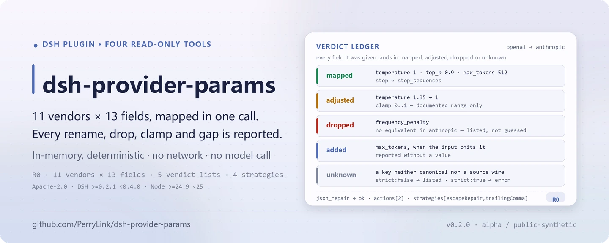

<div align="center">

<picture>
  <source media="(prefers-color-scheme: dark)" srcset="docs/assets/dsh-provider-params-hero-en-dark.webp">
  
</picture>

# dsh-provider-params

**Map request parameters across 11 LLM vendors, then repair broken JSON with fixed rules — every step leaves an auditable record.**

A read-only toolkit for DeepSeek Harness: `params_map` / `params_compare` / `params_vendors` handle `temperature`, `top_p`, `max_tokens`, `stop`, `system` and related fields, while `json_repair` handles trailing commas, raw newlines, and truncation. No network, no file writes, no model calls.

[Install](#three-step-setup) · [Configuration](#configuration) · [FAQ](#faq) · [简体中文](README.md) · [English](README.en.md) · [Español](README.es.md) · [Português](README.pt.md) · [हिन्दी](README.hi.md)

[](LICENSE)
[](#compatibility)
[](https://www.npmjs.com/package/dsh-provider-params)
[](https://github.com/PerryLink/dsh-provider-params/actions/workflows/ci.yml)
[](#compatibility)

[](https://github.com/PerryLink/dsh-provider-params/stargazers)
[](https://www.npmjs.com/package/dsh-provider-params)

```sh
dsh plugin --profile <profile> add dsh-provider-params
```

</div>

<sub>Community plugin, not affiliated with DeepSeek. Canonical repository: <https://github.com/PerryLink/dsh-provider-params>. Status: alpha / public synthetic / not GA; all four tools are R0 (read-only).</sub>

## What it is

`dsh-provider-params` maintains a parameter table of 11 vendors × 13 canonical fields, translates a request fragment from the source vendor's wire names to the target vendor's wire names, and reports what happened item by item: `mapped` is the result, `dropped` means the target has no equivalent, `added` means the target requires it but the input omitted it, `adjusted` means a documented range clamped it, and `unknown` means an unrecognized key. `params_compare` returns a 13-row semantic diff between two vendors, and `params_vendors` lists the field catalog. `json_repair` repairs broken JSON with a fixed sequence of text/structure strategies and returns every edit. All four tools are pure in-memory computation: no network, no file writes, no model calls.

- **A good fit**: moving `temperature`, `top_p`, `max_tokens`, `stop`, `system` and related request fields between OpenAI, Claude, Gemini, ERNIE, Qwen, DeepSeek, Mistral, Cohere, xAI, Groq, and Azure OpenAI; auditing whether a parameter was renamed, dropped, clamped to a documented range, or is required by the target but absent from the source; repairing tool output that contains raw newlines, trailing commas, or a truncated string/container before parsing it.
- **Not a fit**: guessing missing business data or calling a vendor API — this package never invents a value and has no network path; replacing a vendor SDK, auth, streaming, or full request construction — it works on a parameter fragment and text only.

<picture>
  <source media="(prefers-color-scheme: dark)" srcset="docs/assets/dsh-provider-params-flow-v5-dark.svg">
  
</picture>

## Three-step setup

1. **Install** (pick one channel):

   ```sh
   # npm channel (published releases)
   dsh plugin --profile <profile> add dsh-provider-params
   # tarball channel: pnpm pack in this repo, then (prepublishOnly builds first)
   dsh plugin --profile <profile> add ./dsh-provider-params-<version>.tgz
   ```

   The npm package already contains the built `lib/`; installing from a git source requires `pnpm install && pnpm build` in this repo first.

2. **Minimal config** (the install command applies the bundle patch automatically; a hand-written profile pastes this single row):

   ```yaml
   - insert:
       - id: dsh-provider-params
         name: 'dsh-provider-params'
   ```

   The plugin has no plugin-level configuration keys; `cordis.patch.yml` only `insert`s one row, and every behavior is a tool-call argument.

3. **Verify it mounts**:

   ```sh
   dsh --profile <profile> --dump-config | grep dsh-provider-params
   node samples/quickstart/run.mjs
   ```

   The sample prints the real `== params_map ==` and `== json_repair ==` results in order. Inside a session you can also just say:

   ```text
   Use the bundled samples to convert my OpenAI temperature/top_p/max_tokens/stop into Anthropic parameters, then repair my broken JSON that has a raw newline.
   ```

**Uninstall**: `dsh plugin --profile <profile> remove dsh-provider-params` (or remove the row from the profile patch).

## Core capabilities

- **Cross-vendor parameter mapping** — `params_map` takes `from`, `to`, and a `params` object; fields may use source-vendor wire names or canonical names, and Google's `generationConfig` accepts nested or dotted form. It returns `mapped` / `dropped` / `added` / `adjusted` / `unknown`, and `strict: true` rejects unknown keys.
- **Semantic diff audit** — `params_compare` classifies each field as `same / renamed / removed / added / absent` across 13 rows, with wire names, required flags, documented ranges, and notes on both sides.
- **Vendor field catalog** — `params_vendors` lists 11 vendors and their 13 fields with name, support flag, required flag, range, and notes; optional `vendor` filter and `include_unsupported`.
- **Deterministic JSON repair** — `json_repair` runs `escapeRepair`, `trailingComma`, `truncationClosure`, and `fieldCompletion` in a fixed order for at most 1–64 steps; `actions` records every edit and no business value is invented.
- **Read-only and auditable** — all four tools are R0: no file writes, no original-file changes, no network, no model calls; output exists only in the tool result.

### Tool surface

Tool names are a stable API; all four tools are read-only, deterministic, and network-free.

| Tool | Purpose | Risk |
|---|---|---|
| `params_map` | Map a source-vendor request fragment to a target vendor and report mapped/dropped/added/adjusted/unknown | R0 |
| `params_compare` | 13-row semantic parameter comparison between two vendors | R0 |
| `params_vendors` | List 11 vendors and their fields | R0 |
| `json_repair` | Deterministically repair broken JSON and return the action list and placeholders | R0 |

### Input and output

**Input**

- `params_map`: `from`, `to`, and a JSON `params` object. Fields may use source-vendor wire names or canonical names; Google's `generationConfig` may be nested or dotted. Optional `strict: true` rejects unknown keys.
- `params_compare`: two vendor ids.
- `params_vendors`: optional `vendor` filter and `include_unsupported`.
- `json_repair`: `text` (UTF-8, fences accepted), optional `schema` (subset: `type/properties/required/additionalProperties/items/enum/const`), optional four strategy switches, optional `max_steps` 1–64.
- Scale: text is scanned in memory and constrained by the host's per-tool-call argument limit; the package reads no files.
- Bundled samples: `samples/quickstart/input/params-request.json` and `samples/quickstart/input/broken-tool-output.json`.

**Output**

- `params_map`: the target wire object (`mapped`) plus `dropped` (no equivalent), `added` (required by the target but absent from the input, **without a value**), `adjusted` (clamped to a documented range), and `unknown` (unrecognized keys).
- `params_compare`: 13 semantic rows classified `same / renamed / removed / added / absent`, with both wire names, required flags, documented ranges, and notes.
- `params_vendors`: supported vendors and their fields (name, support flag, required flag, range, notes).
- `json_repair`: `ok`, `repaired` (text or `null`), `value`, `actions` (every edit), `strategies`, `truncated`, `validated`, `placeholders`, `error`.
- Nothing is written to disk and the input file is never modified. All four tools are R0 (read-only).

### Examples

The samples cover an OpenAI → Anthropic parameter migration and a tool output with a raw newline and a trailing comma:

```sh
node samples/quickstart/run.mjs
```

- [`params-request.json`](samples/quickstart/input/params-request.json) maps OpenAI `temperature: 1.35` to Anthropic `temperature: 1` (documented 0..1 clamp, recorded in `adjusted` as 1.35 → 1), renames `stop` to `stop_sequences`, and drops `frequency_penalty` because Anthropic has no equivalent. Golden: [`params-mapped.json`](samples/quickstart/expected/params-mapped.json).
- [`broken-tool-output.json`](samples/quickstart/input/broken-tool-output.json) contains a raw newline inside `note` and a trailing comma. The repair records an `escape` action and a `strip` action with `strategies: escapeRepair,trailingComma`. Golden: [`json-repaired.json`](samples/quickstart/expected/json-repaired.json).


*The screenshot is rendered from real `node --test test/params.test.mjs test/repair.test.mjs` output (24/24 passed); the command, date, and hash are recorded in `screenshots.json`. The full suite is 5 test files and 36 cases.*

### Mapping rules

1. **Only what the table states.** A `supported: false` cell is dropped with a reason, never renamed to a plausible-looking field.
2. **Required does not mean invented.** Anthropic `max_tokens` is required; if the input omits it, it appears in `added` and never in `mapped` with a fabricated value.
3. **Clamp only documented ranges.** ERNIE `temperature` (0.01..1) and Anthropic `temperature` (0..1) are enforced; other documented notes do not silently rewrite a value.
4. **Conflicting aliases fail.** Supplying a canonical name and a source wire name with different values returns `E_PARAMS_CONFLICT`.
5. **Google nesting.** `generationConfig.*` is emitted as a nested object; nested input is accepted too.

### JSON repair rules

The pipeline is fixed and never calls a model:

| Strategy | Does | Does not |
|---|---|---|
| `escapeRepair` | Escapes raw control characters inside strings (`\n`, `\t`, `\uXXXX`) | Touch whitespace outside strings |
| `trailingComma` | Removes a comma directly before `}` / `]` | Remove a real separator |
| `truncationClosure` | Closes a truncated string and open containers | Guess missing business data |
| `fieldCompletion` | Writes `null` for a missing required field on an existing object | Create a missing parent object or invent a value |

`json_repair` accepts object/array roots only; other roots return `E_JSON_NOT_CONTAINER`. The schema subset is `type`, `properties`, `required`, `additionalProperties`, `items`, `enum`, `const`. Other keywords are rejected with `E_JSON_SCHEMA_UNSUPPORTED` rather than validating nothing. A value that still violates the schema fails closed with `E_JSON_SCHEMA_VIOLATION`, and the original broken text is never reported as success.

## Measured data

`node scripts/acceptance.mjs` re-runs the public/synthetic acceptance checks; all six rows pass, quoted verbatim from [`ACCEPTANCE.csv`](ACCEPTANCE.csv):

| req_id | Metric | Threshold | Actual | Result |
|---|---|---|---|---|
| PP-A01 | vendors listed | 11 | 11 | true |
| PP-A02 | canonical field count | 13 | 13 | true |
| PP-A03 | vendor-pair mappings clean | 121 | 121 | true |
| PP-A04 | deterministic repair strategies | 4 | 4 | true |
| PP-A05 | quickstart goldens match | 2 | 2 | true |
| PP-A06 | null placeholders reported | 1 | 1 | true |

Every acceptance row is `source=public/synthetic` and `counted=false`; the evidence hash is written to `ACCEPTANCE.csv`. These are public/synthetic checks — no customer data or customer evidence.

## Configuration

This plugin has no Schemastery `Config` keys — `cordis.patch.yml` only `insert`s one row (see "Three-step setup"), so there is no plugin-level key to override. Every adjustable behavior is a tool-call argument.

Most-used parameters:

| Parameter | Tool | Default | Meaning |
|---|---|---|---|
| `from` | `params_map` / `params_compare` | required | Source vendor id; see `params_vendors` for the 11 ids |
| `to` | `params_map` / `params_compare` | required | Target vendor id |
| `params` | `params_map` | required | Request fragment; source wire names or canonical names |
| `strict` | `params_map` | `false` | `true` rejects unknown keys with `E_PARAMS_UNKNOWN_PARAM` |
| `text` | `json_repair` | required | JSON text to repair; markdown fences accepted |
| `max_steps` | `json_repair` | `8` | Scan/apply passes for text/structure repair, 1–64 |

<details>
<summary>Full parameter table (10 entries)</summary>

| Parameter | Tool | Default | Meaning |
|---|---|---|---|
| `from` | `params_map` / `params_compare` | required | Source vendor id |
| `to` | `params_map` / `params_compare` | required | Target vendor id |
| `params` | `params_map` | required | Request fragment |
| `strict` | `params_map` | `false` | Whether unknown keys fail |
| `vendor` | `params_vendors` | all | List one vendor only; case-insensitive |
| `include_unsupported` | `params_vendors` | `false` | Include fields with no equivalent |
| `text` | `json_repair` | required | JSON text to repair |
| `schema` | `json_repair` | none | Schema in the supported subset, used for completion and final validation |
| `strategies` | `json_repair` | all four on | `escape_repair` / `trailing_comma` / `truncation_closure` / `field_completion` |
| `max_steps` | `json_repair` | `8` | Integer 1–64 |

</details>

## FAQ

<details>
<summary>It installs but I cannot see the tools. What now?</summary>

Check that the profile loaded this package: `dsh --profile <profile> --dump-config | grep dsh-provider-params`. The plugin depends on the `tools` service only; if the host does not provide it, mounting fails. Error codes and troubleshooting steps are in [`TROUBLESHOOTING.md`](TROUBLESHOOTING.md).

</details>

<details>
<summary>The mapped result looks different from what I expected.</summary>

Inspect `dropped` and `adjusted` first: the target may have no equivalent, or a documented range may have clamped the value. Use `params_compare` to see both wire names and ranges. Unknown keys appear in `unknown`; they never silently enter the result.

</details>

<details>
<summary>Can it process my files?</summary>

Not directly. Pass JSON text as `json_repair.text` and a parameter object as `params_map.params`. It does not read disk, call the network, or call a model.

</details>

<details>
<summary>Does it invent missing fields?</summary>

No. `added` reports target-required fields without values. Required-field completion writes only `null` placeholders and reports their paths in `placeholders`; the caller must supply real values.

</details>

<details>
<summary>How does it relate to the published <code>dsh-translate</code>?</summary>

This package rewrites the vendor parameter mapping and deterministic JSON repair from `dsh-translate` into the new package structure, with new tests and docs; `dsh-translate` stays as-is. Both are PerryLink-owned code under Apache-2.0.

</details>

## Security boundaries

- **Read-only, never persisted.** All four tools write no files and modify no originals; output exists only in the tool result, and no state survives the call.
- **No network, no model calls.** The source contains no HTTP / DNS / WebSocket calls and no model-call path; `dsh.demo.network` is `false`.
- **No invented values.** `added` reports target-required fields that are missing, without values; `json_repair` field completion writes only `null` placeholders, reports their paths in `placeholders`, and leaves real values to the caller.
- **Ranges clamp only where documented.** ERNIE `temperature` (0.01..1) and Anthropic `temperature` (0..1) are the only explicit clamps; notes on other vendors never rewrite a value.
- **Fail closed.** Unsupported schema keywords, a value that still violates the schema, unknown strategy names, and an out-of-range `max_steps` all fail loudly; the original broken text is never reported as success.

### Permissions and data

- **Read**: the caller-supplied parameter object or JSON text; no other directory.
- **Write**: none (R0, no file writes, originals untouched).
- **Network**: no (no request path and no network switch).
- **External systems**: none.

### Error codes

| Code | Meaning | Next step |
|---|---|---|
| `E_PARAMS_UNKNOWN_VENDOR` | Vendor id is not in the table | Use `params_vendors` to see the 11 ids |
| `E_PARAMS_UNKNOWN_PARAM` | Unknown key under `strict: true` | Remove the key or use `strict: false` |
| `E_PARAMS_CONFLICT` | One parameter supplied twice with different values | Keep a single spelling |
| `E_JSON_NOT_CONTAINER` | Text root is not an object or array | Pass the `{...}` / `[...]` fragment from the tool output |
| `E_JSON_UNREPAIRABLE` | Text still cannot parse under the enabled strategies | Toggle strategies and retry, or have the upstream return complete JSON |
| `E_JSON_SCHEMA_VIOLATION` | Repaired value still violates the schema | Follow the path in `error.message` and supply the real value |
| `E_JSON_SCHEMA_UNSUPPORTED` | Schema uses an unsupported keyword | Use the supported subset |

More troubleshooting steps are in [`TROUBLESHOOTING.md`](TROUBLESHOOTING.md).

## Known limitations

- **The table is static documentation data.** The 11 vendors × 13 canonical fields were organized from public API docs; the three `ported` vendors (OpenAI, ERNIE, Qwen) come from GPT-Rosetta-Stone, and the `extended` rows follow each vendor's public API reference. There is no live vendor API replay, so official docs win when a vendor changes.
- **Only 13 canonical fields are covered.** Vendor-specific extras are not modeled; they surface as `unknown` when mapping or are simply absent from the comparison table.
- **JSON repair is a text/structure heuristic.** It does not understand business semantics and can still return `E_JSON_UNREPAIRABLE`; `schema` supports the declared subset only, not `oneOf`, `$ref`, `allOf`, and similar keywords.
- **Not a vendor SDK.** It does not replace auth, streaming, retries, or full request construction; it handles a parameter fragment and text only.
- **It does not read files.** JSON must be passed as `text`; large text is bounded by the host's per-tool-call argument limit.
- **alpha / public synthetic / not GA.** Verified with public or synthetic samples only; no customer data or customer evidence, and no production-readiness claim.

## Compatibility

| Surface | Status |
|---|---|
| Harness | `dsh >=0.2.1-rc.3 <0.4.0` (`engines.dsh` in `package.json`) |
| Node | `>=24.9.0 <25` (`engines.node` in `package.json`) |
| Platforms | All; in-memory computation only |
| Data | No network, no model call, no upload |
| Dependencies | `@deepseek-ai/cordis`, `@deepseek-ai/dsh-tools` (optional peer); no new runtime dependency |
| Tools | All four tools are R0 (read-only) |

## Ecosystem & quality

- [PerryLink plugin index](https://perrylink.github.io/dsh-plugins/): this package's page is [dsh-provider-params](https://perrylink.github.io/dsh-plugins/packages/dsh-provider-params.html) (version and npm link)
- [Plugin family overview](https://perrylink.github.io/dsh-plugins/family.html) (all Apache-2.0)
- [npm package page](https://www.npmjs.com/package/dsh-provider-params) (version and downloads)

## Development

```sh
pnpm install
pnpm build
pnpm lint
pnpm typecheck
node --test test/*.test.mjs
node scripts/gate.mjs
```

`node scripts/gate.mjs` runs lint, `tsc --noEmit`, the build, the acceptance script, and every test. Acceptance rows are written to `ACCEPTANCE.csv` as public/synthetic, `counted=false`.

Current version `0.2.0` (matches `package.json`); the test suite has 5 files and 36 cases. Layout:

| Path | Contents |
|---|---|
| `src/core/` | Pure-function core: `rosetta` (table), `mapping`, `repair`, `json`, `errors`; no Cordis dependency |
| `src/plugin/` | `index.ts` (apply) and `tools.ts` (the four tool definitions) |
| `test/` | `params` / `repair` / `plugin-smoke` / `samples` / `tool-name-wire` `node --test` suites |
| `samples/quickstart/` | Synthetic inputs, golden outputs, and `run.mjs` |
| `scripts/` | `acceptance.mjs`, `gate.mjs`, `lint.mjs`, `gen-readme-assets.py` |
| `docs/assets/` | README images (light/dark hero SVG, quickstart screenshot) |

The README images are generated programmatically by [`scripts/gen-readme-assets.py`](scripts/gen-readme-assets.py) (Python + Pillow; light/dark SVG flow shared by all five languages) and are safe to re-run:

```sh
python scripts/gen-readme-assets.py
```

Topics: `deepseek-harness`, `dsh`, `dsh-plugin`, `provider`, `parameter-mapping`, `json-repair`, `llm-api`, `perrylink`

## Family & thanks

This project is part of the DeepSeek Harness plugin family from [PerryLink](https://github.com/PerryLink) (all Apache-2.0). If it is useful, **a star helps the next person find it** — nothing is gated behind it.

- [@PerryLink](https://github.com/PerryLink) — creator and maintainer: the 11-vendor parameter table, the four read-only tools, the quickstart sample and acceptance suite, and the five-language docs.
- The three `ported` vendor rows come from PerryLink's GPT-Rosetta-Stone (Apache-2.0); this package rewrites the vendor parameter mapping and deterministic JSON repair from `dsh-translate` into the new package structure.

<details>
<summary>Expand all plugins</summary>

| Plugin | Status |
|---|---|
| **[dsh-aqua-input-check](https://github.com/PerryLink/dsh-aqua-input-check)** |  |
| **[dsh-archive-check](https://github.com/PerryLink/dsh-archive-check)** |  |
| **[dsh-auto-review](https://github.com/PerryLink/dsh-auto-review)** |  |
| **[dsh-autotier](https://github.com/PerryLink/dsh-autotier)** | 🧊 FROZEN — see the repo README |
| **[dsh-bid-ca-precheck](https://github.com/PerryLink/dsh-bid-ca-precheck)** |  |
| **[dsh-bid-qual-check](https://github.com/PerryLink/dsh-bid-qual-check)** |  |
| **[dsh-cert-mcp](https://github.com/PerryLink/dsh-cert-mcp)** | 🧊 FROZEN — see the repo README |
| **[dsh-checkpoint-rewind](https://github.com/PerryLink/dsh-checkpoint-rewind)** |  |
| **[dsh-click](https://github.com/PerryLink/dsh-click)** |  |
| **[dsh-composer-history](https://github.com/PerryLink/dsh-composer-history)** |  |
| **[dsh-contract-stance](https://github.com/PerryLink/dsh-contract-stance)** |  |
| **[dsh-customs-doc-check](https://github.com/PerryLink/dsh-customs-doc-check)** |  |
| **[dsh-data-quality](https://github.com/PerryLink/dsh-data-quality)** |  |
| **[dsh-demurrage-ledger](https://github.com/PerryLink/dsh-demurrage-ledger)** |  |
| **[dsh-doublecheck](https://github.com/PerryLink/dsh-doublecheck)** |  |
| **[dsh-drill-script-check](https://github.com/PerryLink/dsh-drill-script-check)** |  |
| **[dsh-eia-guide-check](https://github.com/PerryLink/dsh-eia-guide-check)** |  |
| **[dsh-emergency-plan](https://github.com/PerryLink/dsh-emergency-plan)** |  |
| **[dsh-essay-rubric-check](https://github.com/PerryLink/dsh-essay-rubric-check)** |  |
| **[dsh-evidence-check](https://github.com/PerryLink/dsh-evidence-check)** |  |
| **[dsh-export-ctl-check](https://github.com/PerryLink/dsh-export-ctl-check)** |  |
| **[dsh-fast](https://github.com/PerryLink/dsh-fast)** |  |
| **[dsh-fmea-table-check](https://github.com/PerryLink/dsh-fmea-table-check)** |  |
| **[dsh-forecast-penalty](https://github.com/PerryLink/dsh-forecast-penalty)** |  |
| **[dsh-fund-research](https://github.com/PerryLink/dsh-fund-research)** |  |
| **[dsh-github](https://github.com/PerryLink/dsh-github)** |  |
| **[dsh-gongwen-flow-check](https://github.com/PerryLink/dsh-gongwen-flow-check)** |  |
| **[dsh-gongwen-word-check](https://github.com/PerryLink/dsh-gongwen-word-check)** |  |
| **[dsh-guard-plan-qc](https://github.com/PerryLink/dsh-guard-plan-qc)** |  |
| **[dsh-hazchem-check](https://github.com/PerryLink/dsh-hazchem-check)** |  |
| **[dsh-hazplan-check](https://github.com/PerryLink/dsh-hazplan-check)** |  |
| **[dsh-hidden-risk-map](https://github.com/PerryLink/dsh-hidden-risk-map)** |  |
| **[dsh-hs-classify](https://github.com/PerryLink/dsh-hs-classify)** |  |
| **[dsh-icd-rule-check](https://github.com/PerryLink/dsh-icd-rule-check)** |  |
| **[dsh-industry-research](https://github.com/PerryLink/dsh-industry-research)** |  |
| **[dsh-lawcite-adapter](https://github.com/PerryLink/dsh-lawcite-adapter)** |  |
| **[dsh-laya](https://github.com/PerryLink/dsh-laya)** |  |
| **[dsh-lc-doc-check](https://github.com/PerryLink/dsh-lc-doc-check)** |  |
| **[dsh-learning-gap-check](https://github.com/PerryLink/dsh-learning-gap-check)** |  |
| **[dsh-library](https://github.com/PerryLink/dsh-library)** |  |
| **[dsh-local-ai](https://github.com/PerryLink/dsh-local-ai)** |  |
| **[dsh-lsp-actions](https://github.com/PerryLink/dsh-lsp-actions)** |  |
| **[dsh-mask](https://github.com/PerryLink/dsh-mask)** |  |
| **[dsh-mcp-panel](https://github.com/PerryLink/dsh-mcp-panel)** |  |
| **[dsh-medrec-qc](https://github.com/PerryLink/dsh-medrec-qc)** |  |
| **[dsh-memento](https://github.com/PerryLink/dsh-memento)** |  |
| **[dsh-nsfc-form-check](https://github.com/PerryLink/dsh-nsfc-form-check)** |  |
| **[dsh-nurse-record-check](https://github.com/PerryLink/dsh-nurse-record-check)** |  |
| **[dsh-observe](https://github.com/PerryLink/dsh-observe)** |  |
| **[dsh-origin-rvc-check](https://github.com/PerryLink/dsh-origin-rvc-check)** |  |
| **[dsh-ota-review-check](https://github.com/PerryLink/dsh-ota-review-check)** |  |
| **[dsh-output-styles](https://github.com/PerryLink/dsh-output-styles)** |  |
| **[dsh-paper-doc-adapter](https://github.com/PerryLink/dsh-paper-doc-adapter)** |  |
| **[dsh-permission-rules](https://github.com/PerryLink/dsh-permission-rules)** |  |
| **[dsh-permit-report-check](https://github.com/PerryLink/dsh-permit-report-check)** |  |
| **[dsh-pipeline-check](https://github.com/PerryLink/dsh-pipeline-check)** |  |
| **[dsh-pleading-draft](https://github.com/PerryLink/dsh-pleading-draft)** |  |
| **[dsh-plugin-doctor](https://github.com/PerryLink/dsh-plugin-doctor)** | 🚫 RETIRED (repo archived) |
| **[dsh-plugin-guide](https://github.com/PerryLink/dsh-plugin-guide)** |  |
| **[dsh-plugin-kit](https://github.com/PerryLink/dsh-plugin-kit)** | 🚫 RETIRED (repo archived) |
| **[dsh-plugin-upgrade](https://github.com/PerryLink/dsh-plugin-upgrade)** | 🚫 RETIRED (repo archived) |
| **[dsh-policy-brief-draft](https://github.com/PerryLink/dsh-policy-brief-draft)** |  |
| **[dsh-power-loss-split](https://github.com/PerryLink/dsh-power-loss-split)** |  |
| **[dsh-power-ticket-check](https://github.com/PerryLink/dsh-power-ticket-check)** |  |
| **[dsh-ppap-check](https://github.com/PerryLink/dsh-ppap-check)** |  |
| **[dsh-protest-deadline](https://github.com/PerryLink/dsh-protest-deadline)** |  |
| **[dsh-railway-window](https://github.com/PerryLink/dsh-railway-window)** |  |
| **[dsh-repair-order-qc](https://github.com/PerryLink/dsh-repair-order-qc)** |  |
| **[dsh-research-report](https://github.com/PerryLink/dsh-research-report)** |  |
| **[dsh-review-reply-check](https://github.com/PerryLink/dsh-review-reply-check)** |  |
| **[dsh-rulefile-check](https://github.com/PerryLink/dsh-rulefile-check)** |  |
| **[dsh-safety-brief-check](https://github.com/PerryLink/dsh-safety-brief-check)** |  |
| **[dsh-score](https://github.com/PerryLink/dsh-score)** |  |
| **[dsh-session-sync](https://github.com/PerryLink/dsh-session-sync)** |  |
| **[dsh-site-log-check](https://github.com/PerryLink/dsh-site-log-check)** |  |
| **[dsh-skill-pack-security](https://github.com/PerryLink/dsh-skill-pack-security)** |  |
| **[dsh-soe-decision-check](https://github.com/PerryLink/dsh-soe-decision-check)** |  |
| **[dsh-soilwater-check](https://github.com/PerryLink/dsh-soilwater-check)** |  |
| **[dsh-sop-sync-check](https://github.com/PerryLink/dsh-sop-sync-check)** |  |
| **[dsh-spc-gbt-adapter](https://github.com/PerryLink/dsh-spc-gbt-adapter)** |  |
| **[dsh-talk](https://github.com/PerryLink/dsh-talk)** |  |
| **[dsh-tender-extract](https://github.com/PerryLink/dsh-tender-extract)** |  |
| **[dsh-tender-matrix](https://github.com/PerryLink/dsh-tender-matrix)** |  |
| **[dsh-test-drive](https://github.com/PerryLink/dsh-test-drive)** |  |
| **[dsh-ticktick](https://github.com/PerryLink/dsh-ticktick)** | 🚫 RETIRED (repo archived) |
| **[dsh-translate](https://github.com/PerryLink/dsh-translate)** |  |
| **[dsh-warranty-calc](https://github.com/PerryLink/dsh-warranty-calc)** |  |
| **[dsh-budget](https://github.com/PerryLink/dsh-budget)** | 🧊 FROZEN — see the repo README |
| **[dsh-claude-move](https://github.com/PerryLink/dsh-claude-move)** | 🧊 FROZEN — see the repo README |
| **[dsh-defend](https://github.com/PerryLink/dsh-defend)** | 🧊 FROZEN — see the repo README |
| **[dsh-draw](https://github.com/PerryLink/dsh-draw)** | 🧊 FROZEN — see the repo README |
| **[dsh-reach](https://github.com/PerryLink/dsh-reach)** | 🧊 FROZEN — see the repo README |
| **[dsh-background-agents](https://github.com/PerryLink/dsh-background-agents)** | 🚫 RETIRED (repo archived) |
| **[dsh-session-pin](https://github.com/PerryLink/dsh-session-pin)** | 🚫 RETIRED (repo archived) |
| **[dsh-team-rooms](https://github.com/PerryLink/dsh-team-rooms)** | 🚫 RETIRED (repo archived) |

</details>

## License

[LICENSE](LICENSE) (Apache License 2.0) © 2026 dsh-provider-params contributors

<p align="center"><sub>Apache-2.0 · Community plugin, not affiliated with DeepSeek.</sub></p>
