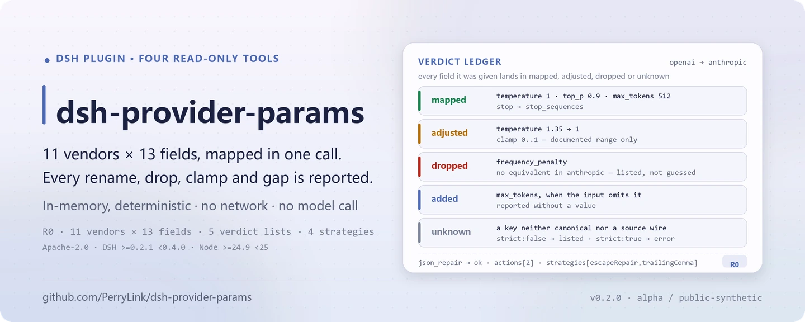

<div align="center">

<picture>
  <source media="(prefers-color-scheme: dark)" srcset="docs/assets/dsh-provider-params-hero-en-dark.webp">
  
</picture>

# dsh-provider-params

**Convierte parámetros de petición entre 11 proveedores de LLM y repara JSON roto con reglas fijas: cada paso deja un registro auditable.**

Un conjunto de herramientas de solo lectura para DeepSeek Harness: `params.map` / `params.compare` / `params.vendors` manejan `temperature`, `top_p`, `max_tokens`, `stop`, `system` y campos relacionados, mientras que `json.repair` trata comas finales, saltos de línea sin escapar y truncamientos. Sin red, sin escritura de archivos y sin llamadas a un modelo.

[Instalar](#instalación-en-tres-pasos) · [Configuración](#configuración) · [FAQ](#faq) · [简体中文](README.md) · [English](README.en.md) · [Español](README.es.md) · [Português](README.pt.md) · [हिन्दी](README.hi.md)

[](LICENSE)
[](#compatibilidad)
[](https://www.npmjs.com/package/dsh-provider-params)
[](https://github.com/PerryLink/dsh-provider-params/actions/workflows/ci.yml)
[](#compatibilidad)

[](https://github.com/PerryLink/dsh-provider-params/stargazers)
[](https://www.npmjs.com/package/dsh-provider-params)

```sh
dsh plugin --profile <profile> add dsh-provider-params
```

</div>

<sub>Plugin de la comunidad, no afiliado a DeepSeek. Repositorio canónico: <https://github.com/PerryLink/dsh-provider-params>. Estado: alpha / sintético público / no GA; las cuatro herramientas son R0 (solo lectura).</sub>

## Qué es

`dsh-provider-params` mantiene una tabla de parámetros de 11 proveedores × 13 campos canónicos, traduce un fragmento de petición desde los wire names del proveedor de origen a los del proveedor de destino y reporta qué ocurrió elemento por elemento: `mapped` es el resultado, `dropped` significa que el destino no tiene equivalente, `added` que el destino lo exige pero la entrada no lo dio, `adjusted` que un rango documentado lo recortó y `unknown` que la clave no se reconoce. `params.compare` devuelve una diferencia semántica de 13 filas entre dos proveedores, y `params.vendors` lista el catálogo de campos. `json.repair` repara JSON roto con una secuencia fija de estrategias de texto/estructura y devuelve cada edición. Las cuatro herramientas son cálculo puro en memoria: sin red, sin escritura de archivos y sin llamadas a un modelo.

- **Adecuado para**: mover `temperature`, `top_p`, `max_tokens`, `stop`, `system` y campos relacionados entre OpenAI, Claude, Gemini, ERNIE, Qwen, DeepSeek, Mistral, Cohere, xAI, Groq y Azure OpenAI; auditar si un parámetro fue renombrado, descartado, recortado a un rango documentado o es obligatorio en el destino pero falta en el origen; reparar la salida de una herramienta que trae saltos de línea sin escapar, comas finales o una cadena/contenedor truncado antes de parsearla.
- **No adecuado para**: adivinar datos de negocio ausentes o llamar a la API de un proveedor — este paquete nunca inventa un valor y no tiene ruta de red; sustituir un SDK de proveedor, la autenticación, el streaming o la construcción completa de la petición — solo trabaja sobre un fragmento de parámetros y texto.

<picture>
  <source media="(prefers-color-scheme: dark)" srcset="docs/assets/dsh-provider-params-flow-v5-dark.svg">
  
</picture>

## Instalación en tres pasos

1. **Instalar** (elige un canal):

   ```sh
   # canal npm (versiones publicadas)
   dsh plugin --profile <profile> add dsh-provider-params
   # canal tarball: pnpm pack en este repo y luego (prepublishOnly compila antes)
   dsh plugin --profile <profile> add ./dsh-provider-params-<version>.tgz
   ```

   El paquete npm ya incluye `lib/` compilado; instalar desde el código git requiere `pnpm install && pnpm build` en este repo primero.

2. **Configuración mínima** (el comando de instalación aplica el bundle patch; un perfil escrito a mano pega esta única fila):

   ```yaml
   - insert:
       - id: dsh-provider-params
         name: 'dsh-provider-params'
   ```

   El plugin no tiene claves de configuración propias; `cordis.patch.yml` solo `insert` una fila y todo comportamiento se pasa como argumento de la herramienta.

3. **Verificar que se monta**:

   ```sh
   dsh --profile <profile> --dump-config | grep dsh-provider-params
   node samples/quickstart/run.mjs
   ```

   La muestra imprime en orden los resultados reales `== params.map ==` y `== json.repair ==`. Dentro de una sesión también basta con pedirlo:

   ```text
   Usa las muestras incluidas para convertir mi temperature/top_p/max_tokens/stop de OpenAI en parámetros de Anthropic y luego repara mi JSON roto que trae un salto de línea sin escapar.
   ```

**Desinstalar**: `dsh plugin --profile <profile> remove dsh-provider-params` (o quita la fila del patch del perfil).

## Capacidades clave

- **Mapeo entre proveedores** — `params.map` recibe `from`, `to` y un objeto `params`; los campos pueden usar wire names del origen o nombres canónicos, y `generationConfig` de Google acepta forma anidada o con puntos. Devuelve `mapped` / `dropped` / `added` / `adjusted` / `unknown`, y `strict: true` rechaza claves desconocidas.
- **Auditoría de diferencias semánticas** — `params.compare` clasifica cada campo como `same / renamed / removed / added / absent` en 13 filas, con wire names, obligatoriedad, rangos documentados y notas de ambos lados.
- **Catálogo de campos por proveedor** — `params.vendors` lista 11 proveedores y sus 13 campos con nombre, soporte, obligatoriedad, rango y notas; filtro opcional `vendor` e `include_unsupported`.
- **Reparación determinista de JSON** — `json.repair` ejecuta `escapeRepair`, `trailingComma`, `truncationClosure` y `fieldCompletion` en orden fijo durante 1–64 pasos; `actions` registra cada edición y nunca se inventa un valor de negocio.
- **Solo lectura y auditable** — las cuatro herramientas son R0: sin escritura de archivos, sin modificar originales, sin red y sin llamadas a un modelo; la salida solo existe en el resultado de la herramienta.

### Superficie de herramientas

Los nombres de las herramientas son una API estable; las cuatro son de solo lectura, deterministas y sin red.

| Herramienta | Propósito | Riesgo |
|---|---|---|
| `params.map` | Mapear un fragmento de petición del proveedor de origen al de destino y reportar mapped/dropped/added/adjusted/unknown | R0 |
| `params.compare` | Comparación semántica de parámetros en 13 filas entre dos proveedores | R0 |
| `params.vendors` | Listar 11 proveedores y sus campos | R0 |
| `json.repair` | Reparar JSON roto de forma determinista y devolver la lista de acciones y marcadores | R0 |

### Entrada y salida

**Entrada**

- `params.map`: `from`, `to` y un objeto JSON `params`. Los campos pueden usar wire names del origen o nombres canónicos; `generationConfig` de Google puede ser anidado o con puntos. `strict: true` opcional rechaza claves desconocidas.
- `params.compare`: dos ids de proveedor.
- `params.vendors`: filtro opcional `vendor` e `include_unsupported`.
- `json.repair`: `text` (UTF-8, acepta vallas Markdown), `schema` opcional (subconjunto: `type/properties/required/additionalProperties/items/enum/const`), cuatro interruptores de estrategia opcionales y `max_steps` opcional de 1–64.
- Escala: el texto se escanea en memoria y está acotado por el límite de argumentos por llamada del host; el paquete no lee archivos.
- Muestras incluidas: `samples/quickstart/input/params-request.json` y `samples/quickstart/input/broken-tool-output.json`.

**Salida**

- `params.map`: el objeto wire del destino (`mapped`) más `dropped` (sin equivalente), `added` (obligatorio en el destino pero ausente en la entrada, **sin valor**), `adjusted` (recortado a un rango documentado) y `unknown` (claves no reconocidas).
- `params.compare`: 13 filas semánticas clasificadas `same / renamed / removed / added / absent`, con ambos wire names, obligatoriedad, rangos documentados y notas.
- `params.vendors`: proveedores soportados y sus campos (nombre, soporte, obligatoriedad, rango, notas).
- `json.repair`: `ok`, `repaired` (texto o `null`), `value`, `actions` (cada edición), `strategies`, `truncated`, `validated`, `placeholders`, `error`.
- Nada se escribe en disco y el archivo de entrada nunca se modifica. Las cuatro herramientas son R0 (solo lectura).

### Ejemplos

Las muestras cubren una migración de parámetros de OpenAI → Anthropic y una salida de herramienta con un salto de línea real y una coma final:

```sh
node samples/quickstart/run.mjs
```

- [`params-request.json`](samples/quickstart/input/params-request.json) mapea `temperature: 1.35` de OpenAI a `temperature: 1` de Anthropic (recorte documentado 0..1, registrado en `adjusted` como 1.35 → 1), renombra `stop` a `stop_sequences` y descarta `frequency_penalty` porque Anthropic no tiene equivalente. Oro: [`params-mapped.json`](samples/quickstart/expected/params-mapped.json).
- [`broken-tool-output.json`](samples/quickstart/input/broken-tool-output.json) contiene un salto de línea real dentro de `note` y una coma final. La reparación registra una acción `escape` y una `strip` con `strategies: escapeRepair,trailingComma`. Oro: [`json-repaired.json`](samples/quickstart/expected/json-repaired.json).


*La captura se renderizó a partir de la salida real de `node --test test/params.test.mjs test/repair.test.mjs` (24/24 aprobadas); el comando, la fecha y el hash están en `screenshots.json`. La suite completa son 4 archivos de prueba y 35 casos.*

### Reglas de mapeo

1. **Solo lo que dice la tabla.** Una celda `supported: false` se descarta con un motivo; nunca se renombra a un campo que parezca plausible.
2. **Obligatorio no significa inventado.** `max_tokens` de Anthropic es obligatorio; si la entrada lo omite, aparece en `added` y nunca en `mapped` con un valor fabricado.
3. **Recortar solo rangos documentados.** Se aplican `temperature` de ERNIE (0.01..1) y de Anthropic (0..1); las notas de otros proveedores no reescriben un valor en silencio.
4. **Los alias en conflicto fallan.** Dar un nombre canónico y un wire name del origen con valores distintos devuelve `E_PARAMS_CONFLICT`.
5. **Anidamiento de Google.** `generationConfig.*` se emite como objeto anidado; la entrada anidada también se acepta.

### Reglas de reparación de JSON

La tubería es fija y nunca llama a un modelo:

| Estrategia | Hace | No hace |
|---|---|---|
| `escapeRepair` | Escapa caracteres de control dentro de cadenas (`\n`, `\t`, `\uXXXX`) | Tocar espacios fuera de las cadenas |
| `trailingComma` | Quita una coma justo antes de `}` / `]` | Quitar un separador real |
| `truncationClosure` | Cierra una cadena truncada y los contenedores abiertos | Adivinar datos de negocio ausentes |
| `fieldCompletion` | Escribe `null` para un campo obligatorio ausente en un objeto existente | Crear un objeto padre ausente o inventar un valor |

`json.repair` solo acepta raíces de objeto/array; otras raíces devuelven `E_JSON_NOT_CONTAINER`. El subconjunto de schema es `type`, `properties`, `required`, `additionalProperties`, `items`, `enum`, `const`. Otras palabras clave se rechazan con `E_JSON_SCHEMA_UNSUPPORTED` en lugar de no validar nada. Un valor que aún viola el schema falla cerrado con `E_JSON_SCHEMA_VIOLATION`, y el texto roto original nunca se reporta como éxito.

## Datos medidos

`node scripts/acceptance.mjs` vuelve a ejecutar la aceptación pública/sintética; las seis filas pasan, citadas literalmente de [`ACCEPTANCE.csv`](ACCEPTANCE.csv):

| req_id | Métrica | Umbral | Real | Resultado |
|---|---|---|---|---|
| PP-A01 | vendors listed | 11 | 11 | true |
| PP-A02 | canonical field count | 13 | 13 | true |
| PP-A03 | vendor-pair mappings clean | 121 | 121 | true |
| PP-A04 | deterministic repair strategies | 4 | 4 | true |
| PP-A05 | quickstart goldens match | 2 | 2 | true |
| PP-A06 | null placeholders reported | 1 | 1 | true |

Todas las filas de aceptación son `source=public/synthetic` y `counted=false`; el hash de evidencia se escribe en `ACCEPTANCE.csv`. Son comprobaciones públicas/sintéticas: sin datos ni evidencia de clientes.

## Configuración

Este plugin no tiene claves `Config` de Schemastery — `cordis.patch.yml` solo `insert` una fila (ver «Instalación en tres pasos»), así que no hay ninguna clave de plugin que sobrescribir. Todo comportamiento ajustable es un argumento de la herramienta.

Parámetros más usados:

| Parámetro | Herramienta | Predeterminado | Significado |
|---|---|---|---|
| `from` | `params.map` / `params.compare` | obligatorio | Id del proveedor de origen; los 11 ids están en `params.vendors` |
| `to` | `params.map` / `params.compare` | obligatorio | Id del proveedor de destino |
| `params` | `params.map` | obligatorio | Fragmento de petición; wire names del origen o nombres canónicos |
| `strict` | `params.map` | `false` | `true` rechaza claves desconocidas con `E_PARAMS_UNKNOWN_PARAM` |
| `text` | `json.repair` | obligatorio | Texto JSON a reparar; acepta vallas Markdown |
| `max_steps` | `json.repair` | `8` | Pasadas de escaneo/aplicación para texto/estructura, 1–64 |

<details>
<summary>Tabla completa de parámetros (10 entradas)</summary>

| Parámetro | Herramienta | Predeterminado | Significado |
|---|---|---|---|
| `from` | `params.map` / `params.compare` | obligatorio | Id del proveedor de origen |
| `to` | `params.map` / `params.compare` | obligatorio | Id del proveedor de destino |
| `params` | `params.map` | obligatorio | Fragmento de petición |
| `strict` | `params.map` | `false` | Si las claves desconocidas fallan |
| `vendor` | `params.vendors` | todos | Listar solo un proveedor; sin distinguir mayúsculas |
| `include_unsupported` | `params.vendors` | `false` | Incluir campos sin equivalente |
| `text` | `json.repair` | obligatorio | Texto JSON a reparar |
| `schema` | `json.repair` | ninguno | Schema del subconjunto soportado, para completar y validar al final |
| `strategies` | `json.repair` | las cuatro activas | `escape_repair` / `trailing_comma` / `truncation_closure` / `field_completion` |
| `max_steps` | `json.repair` | `8` | Entero 1–64 |

</details>

## FAQ

<details>
<summary>Se instala pero no veo las herramientas. ¿Qué hago?</summary>

Confirma que el perfil cargó este paquete: `dsh --profile <profile> --dump-config | grep dsh-provider-params`. El plugin solo depende del servicio `tools`; si el host no lo ofrece, el montaje falla. Los códigos de error y los pasos de diagnóstico están en [`TROUBLESHOOTING.md`](TROUBLESHOOTING.md).

</details>

<details>
<summary>El resultado mapeado no es el esperado.</summary>

Revisa primero `dropped` y `adjusted`: puede que el destino no tenga equivalente o que un rango documentado haya recortado el valor. Usa `params.compare` para ver ambos wire names y rangos. Las claves desconocidas aparecen en `unknown`; nunca entran en el resultado en silencio.

</details>

<details>
<summary>¿Puede procesar mis archivos?</summary>

No directamente. Pasa el texto JSON como `json.repair.text` y el objeto de parámetros como `params.map.params`. No lee disco, no llama a la red y no llama a un modelo.

</details>

<details>
<summary>¿Inventa campos ausentes?</summary>

No. `added` reporta los campos obligatorios del destino sin valores. El completado de campos obligatorios escribe solo marcadores `null` y reporta sus rutas en `placeholders`; el llamador debe aportar los valores reales.

</details>

<details>
<summary>¿Qué relación tiene con el publicado <code>dsh-translate</code>?</summary>

Este paquete reescribe el mapeo de parámetros por proveedor y la reparación determinista de JSON de `dsh-translate` en la nueva estructura de paquete, con pruebas y documentación nuevas; `dsh-translate` queda como está. Ambos son código de PerryLink bajo Apache-2.0.

</details>

## Límites de seguridad

- **Solo lectura, nunca persistido.** Las cuatro herramientas no escriben archivos ni modifican originales; la salida solo existe en el resultado de la herramienta y no queda estado tras la llamada.
- **Sin red, sin llamadas a un modelo.** El código no contiene llamadas HTTP / DNS / WebSocket ni una ruta de llamada a modelo; `dsh.demo.network` es `false`.
- **Sin valores inventados.** `added` reporta campos obligatorios del destino que faltan, sin valores; el completado de `json.repair` escribe solo marcadores `null`, reporta sus rutas en `placeholders` y deja los valores reales al llamador.
- **Los rangos recortan solo cuando están documentados.** `temperature` de ERNIE (0.01..1) y de Anthropic (0..1) son los únicos recortes explícitos; las notas de otros proveedores nunca reescriben un valor.
- **Fallo cerrado.** Palabras clave de schema no soportadas, un valor que aún viola el schema, nombres de estrategia desconocidos y un `max_steps` fuera de rango fallan en voz alta; el texto roto original nunca se reporta como éxito.

### Permisos y datos

- **Lee**: el objeto de parámetros o el texto JSON que aporta el llamador; ningún otro directorio.
- **Escribe**: nada (R0, sin escritura de archivos, originales intactos).
- **Red**: no (sin ruta de petición y sin interruptor de red).
- **Sistemas externos**: ninguno.

### Códigos de error

| Código | Significado | Siguiente paso |
|---|---|---|
| `E_PARAMS_UNKNOWN_VENDOR` | El id de proveedor no está en la tabla | Usa `params.vendors` para ver los 11 ids |
| `E_PARAMS_UNKNOWN_PARAM` | Clave desconocida con `strict: true` | Quita la clave o usa `strict: false` |
| `E_PARAMS_CONFLICT` | Un parámetro dado dos veces con valores distintos | Conserva una sola forma |
| `E_JSON_NOT_CONTAINER` | La raíz del texto no es objeto ni array | Pasa el fragmento `{...}` / `[...]` de la salida de la herramienta |
| `E_JSON_UNREPAIRABLE` | El texto sigue sin parsear con las estrategias activas | Alterna estrategias y reintenta, o pide al origen JSON completo |
| `E_JSON_SCHEMA_VIOLATION` | El valor reparado aún viola el schema | Sigue la ruta de `error.message` y aporta el valor real |
| `E_JSON_SCHEMA_UNSUPPORTED` | El schema usa una palabra clave no soportada | Usa el subconjunto soportado |

Más pasos de diagnóstico en [`TROUBLESHOOTING.md`](TROUBLESHOOTING.md).

## Limitaciones conocidas

- **La tabla es datos de documentación estática.** Los 11 proveedores × 13 campos canónicos se organizaron a partir de documentación pública de API; los tres proveedores `ported` (OpenAI, ERNIE, Qwen) vienen de GPT-Rosetta-Stone y las filas `extended` siguen la referencia pública de cada proveedor. No hay reproducción contra la API en vivo, así que la documentación oficial manda cuando un proveedor cambia.
- **Solo se cubren 13 campos canónicos.** Los extras específicos de cada proveedor no se modelan; aparecen como `unknown` al mapear o simplemente no están en la tabla comparativa.
- **La reparación de JSON es una heurística de texto/estructura.** No entiende semántica de negocio y aún puede devolver `E_JSON_UNREPAIRABLE`; `schema` solo soporta el subconjunto declarado, no `oneOf`, `$ref`, `allOf` ni palabras clave similares.
- **No es un SDK de proveedor.** No sustituye autenticación, streaming, reintentos ni la construcción completa de la petición; solo maneja un fragmento de parámetros y texto.
- **No lee archivos.** El JSON debe pasarse como `text`; el texto grande está acotado por el límite de argumentos por llamada del host.
- **alpha / sintético público / no GA.** Verificado solo con muestras públicas o sintéticas; sin datos ni evidencia de clientes, y sin declaración de producción.

## Compatibilidad

| Superficie | Estado |
|---|---|
| Harness | `dsh >=0.2.1-rc.3 <0.4.0` (`engines.dsh` en `package.json`) |
| Node | `>=24.9.0 <25` (`engines.node` en `package.json`) |
| Plataformas | Todas; solo cálculo en memoria |
| Datos | Sin red, sin llamada a modelo, sin subidas |
| Dependencias | `@deepseek-ai/cordis`, `@deepseek-ai/dsh-tools` (peer opcional); sin nueva dependencia de ejecución |
| Herramientas | Las cuatro son R0 (solo lectura) |

## Ecosistema y calidad

- [Índice de plugins de PerryLink](https://perrylink.github.io/dsh-plugins/): la página de este paquete es [dsh-provider-params](https://perrylink.github.io/dsh-plugins/packages/dsh-provider-params.html) (versión y enlace npm)
- [Vista general de la familia de plugins](https://perrylink.github.io/dsh-plugins/family.html) (todo Apache-2.0)
- [Página del paquete en npm](https://www.npmjs.com/package/dsh-provider-params) (versión y descargas)

## Desarrollo

```sh
pnpm install
pnpm build
pnpm lint
pnpm typecheck
node --test test/*.test.mjs
node scripts/gate.mjs
```

`node scripts/gate.mjs` ejecuta lint, `tsc --noEmit`, la compilación, el script de aceptación y todas las pruebas. Las filas de aceptación se escriben en `ACCEPTANCE.csv` como public/synthetic, `counted=false`.

Versión actual `0.1.0` (coincide con `package.json`); la suite tiene 4 archivos y 35 casos. Estructura:

| Ruta | Contenido |
|---|---|
| `src/core/` | Núcleo de funciones puras: `rosetta` (tabla), `mapping`, `repair`, `json`, `errors`; sin dependencia de Cordis |
| `src/plugin/` | `index.ts` (apply) y `tools.ts` (las cuatro definiciones de herramienta) |
| `test/` | Suites `node --test` de `params` / `repair` / `plugin-smoke` / `samples` |
| `samples/quickstart/` | Entradas sintéticas, salidas de oro y `run.mjs` |
| `scripts/` | `acceptance.mjs`, `gate.mjs`, `lint.mjs`, `gen-readme-assets.py` |
| `docs/assets/` | Imágenes del README (hero SVG claro/oscuro, captura de quickstart) |

Las imágenes del README se generan programáticamente con [`scripts/gen-readme-assets.py`](scripts/gen-readme-assets.py) (Python + Pillow; flujo SVG claro/oscuro compartido por los cinco idiomas) y se pueden repetir:

```sh
python scripts/gen-readme-assets.py
```

Topics: `deepseek-harness`, `dsh`, `dsh-plugin`, `provider`, `parameter-mapping`, `json-repair`, `llm-api`, `perrylink`

## Familia y agradecimientos

Este proyecto forma parte de la familia de plugins de DeepSeek Harness de [PerryLink](https://github.com/PerryLink) (todos Apache-2.0). Si te resulta útil, **una estrella ayuda a que la siguiente persona lo encuentre** — no hay nada bloqueado tras ella.

- [@PerryLink](https://github.com/PerryLink) — creador y mantenedor: la tabla de 11 proveedores, las cuatro herramientas de solo lectura, la muestra quickstart y la suite de aceptación, y la documentación en cinco idiomas.
- Las tres filas `ported` vienen de GPT-Rosetta-Stone de PerryLink (Apache-2.0); este paquete reescribe el mapeo de parámetros por proveedor y la reparación determinista de JSON de `dsh-translate` en la nueva estructura.

<details>
<summary>Expandir todos los plugins</summary>

| Plugin | Estado |
|---|---|
| **[dsh-aqua-input-check](https://github.com/PerryLink/dsh-aqua-input-check)** |  |
| **[dsh-archive-check](https://github.com/PerryLink/dsh-archive-check)** |  |
| **[dsh-auto-review](https://github.com/PerryLink/dsh-auto-review)** |  |
| **[dsh-autotier](https://github.com/PerryLink/dsh-autotier)** | 🧊 CONGELADO — ver el README del repo |
| **[dsh-bid-ca-precheck](https://github.com/PerryLink/dsh-bid-ca-precheck)** |  |
| **[dsh-bid-qual-check](https://github.com/PerryLink/dsh-bid-qual-check)** |  |
| **[dsh-cert-mcp](https://github.com/PerryLink/dsh-cert-mcp)** | 🧊 CONGELADO — ver el README del repo |
| **[dsh-checkpoint-rewind](https://github.com/PerryLink/dsh-checkpoint-rewind)** |  |
| **[dsh-click](https://github.com/PerryLink/dsh-click)** |  |
| **[dsh-composer-history](https://github.com/PerryLink/dsh-composer-history)** |  |
| **[dsh-contract-stance](https://github.com/PerryLink/dsh-contract-stance)** |  |
| **[dsh-customs-doc-check](https://github.com/PerryLink/dsh-customs-doc-check)** |  |
| **[dsh-data-quality](https://github.com/PerryLink/dsh-data-quality)** |  |
| **[dsh-demurrage-ledger](https://github.com/PerryLink/dsh-demurrage-ledger)** |  |
| **[dsh-doublecheck](https://github.com/PerryLink/dsh-doublecheck)** |  |
| **[dsh-drill-script-check](https://github.com/PerryLink/dsh-drill-script-check)** |  |
| **[dsh-eia-guide-check](https://github.com/PerryLink/dsh-eia-guide-check)** |  |
| **[dsh-emergency-plan](https://github.com/PerryLink/dsh-emergency-plan)** |  |
| **[dsh-essay-rubric-check](https://github.com/PerryLink/dsh-essay-rubric-check)** |  |
| **[dsh-evidence-check](https://github.com/PerryLink/dsh-evidence-check)** |  |
| **[dsh-export-ctl-check](https://github.com/PerryLink/dsh-export-ctl-check)** |  |
| **[dsh-fast](https://github.com/PerryLink/dsh-fast)** |  |
| **[dsh-fmea-table-check](https://github.com/PerryLink/dsh-fmea-table-check)** |  |
| **[dsh-forecast-penalty](https://github.com/PerryLink/dsh-forecast-penalty)** |  |
| **[dsh-fund-research](https://github.com/PerryLink/dsh-fund-research)** |  |
| **[dsh-github](https://github.com/PerryLink/dsh-github)** |  |
| **[dsh-gongwen-flow-check](https://github.com/PerryLink/dsh-gongwen-flow-check)** |  |
| **[dsh-gongwen-word-check](https://github.com/PerryLink/dsh-gongwen-word-check)** |  |
| **[dsh-guard-plan-qc](https://github.com/PerryLink/dsh-guard-plan-qc)** |  |
| **[dsh-hazchem-check](https://github.com/PerryLink/dsh-hazchem-check)** |  |
| **[dsh-hazplan-check](https://github.com/PerryLink/dsh-hazplan-check)** |  |
| **[dsh-hidden-risk-map](https://github.com/PerryLink/dsh-hidden-risk-map)** |  |
| **[dsh-hs-classify](https://github.com/PerryLink/dsh-hs-classify)** |  |
| **[dsh-icd-rule-check](https://github.com/PerryLink/dsh-icd-rule-check)** |  |
| **[dsh-industry-research](https://github.com/PerryLink/dsh-industry-research)** |  |
| **[dsh-lawcite-adapter](https://github.com/PerryLink/dsh-lawcite-adapter)** |  |
| **[dsh-laya](https://github.com/PerryLink/dsh-laya)** |  |
| **[dsh-lc-doc-check](https://github.com/PerryLink/dsh-lc-doc-check)** |  |
| **[dsh-learning-gap-check](https://github.com/PerryLink/dsh-learning-gap-check)** |  |
| **[dsh-library](https://github.com/PerryLink/dsh-library)** |  |
| **[dsh-local-ai](https://github.com/PerryLink/dsh-local-ai)** |  |
| **[dsh-lsp-actions](https://github.com/PerryLink/dsh-lsp-actions)** |  |
| **[dsh-mask](https://github.com/PerryLink/dsh-mask)** |  |
| **[dsh-mcp-panel](https://github.com/PerryLink/dsh-mcp-panel)** |  |
| **[dsh-medrec-qc](https://github.com/PerryLink/dsh-medrec-qc)** |  |
| **[dsh-memento](https://github.com/PerryLink/dsh-memento)** |  |
| **[dsh-nsfc-form-check](https://github.com/PerryLink/dsh-nsfc-form-check)** |  |
| **[dsh-nurse-record-check](https://github.com/PerryLink/dsh-nurse-record-check)** |  |
| **[dsh-observe](https://github.com/PerryLink/dsh-observe)** |  |
| **[dsh-origin-rvc-check](https://github.com/PerryLink/dsh-origin-rvc-check)** |  |
| **[dsh-ota-review-check](https://github.com/PerryLink/dsh-ota-review-check)** |  |
| **[dsh-output-styles](https://github.com/PerryLink/dsh-output-styles)** |  |
| **[dsh-paper-doc-adapter](https://github.com/PerryLink/dsh-paper-doc-adapter)** |  |
| **[dsh-permission-rules](https://github.com/PerryLink/dsh-permission-rules)** |  |
| **[dsh-permit-report-check](https://github.com/PerryLink/dsh-permit-report-check)** |  |
| **[dsh-pipeline-check](https://github.com/PerryLink/dsh-pipeline-check)** |  |
| **[dsh-pleading-draft](https://github.com/PerryLink/dsh-pleading-draft)** |  |
| **[dsh-plugin-doctor](https://github.com/PerryLink/dsh-plugin-doctor)** | 🚫 RETIRADO (repo archivado) |
| **[dsh-plugin-guide](https://github.com/PerryLink/dsh-plugin-guide)** |  |
| **[dsh-plugin-kit](https://github.com/PerryLink/dsh-plugin-kit)** | 🚫 RETIRADO (repo archivado) |
| **[dsh-plugin-upgrade](https://github.com/PerryLink/dsh-plugin-upgrade)** | 🚫 RETIRADO (repo archivado) |
| **[dsh-policy-brief-draft](https://github.com/PerryLink/dsh-policy-brief-draft)** |  |
| **[dsh-power-loss-split](https://github.com/PerryLink/dsh-power-loss-split)** |  |
| **[dsh-power-ticket-check](https://github.com/PerryLink/dsh-power-ticket-check)** |  |
| **[dsh-ppap-check](https://github.com/PerryLink/dsh-ppap-check)** |  |
| **[dsh-protest-deadline](https://github.com/PerryLink/dsh-protest-deadline)** |  |
| **[dsh-railway-window](https://github.com/PerryLink/dsh-railway-window)** |  |
| **[dsh-repair-order-qc](https://github.com/PerryLink/dsh-repair-order-qc)** |  |
| **[dsh-research-report](https://github.com/PerryLink/dsh-research-report)** |  |
| **[dsh-review-reply-check](https://github.com/PerryLink/dsh-review-reply-check)** |  |
| **[dsh-rulefile-check](https://github.com/PerryLink/dsh-rulefile-check)** |  |
| **[dsh-safety-brief-check](https://github.com/PerryLink/dsh-safety-brief-check)** |  |
| **[dsh-score](https://github.com/PerryLink/dsh-score)** |  |
| **[dsh-session-sync](https://github.com/PerryLink/dsh-session-sync)** |  |
| **[dsh-site-log-check](https://github.com/PerryLink/dsh-site-log-check)** |  |
| **[dsh-skill-pack-security](https://github.com/PerryLink/dsh-skill-pack-security)** |  |
| **[dsh-soe-decision-check](https://github.com/PerryLink/dsh-soe-decision-check)** |  |
| **[dsh-soilwater-check](https://github.com/PerryLink/dsh-soilwater-check)** |  |
| **[dsh-sop-sync-check](https://github.com/PerryLink/dsh-sop-sync-check)** |  |
| **[dsh-spc-gbt-adapter](https://github.com/PerryLink/dsh-spc-gbt-adapter)** |  |
| **[dsh-talk](https://github.com/PerryLink/dsh-talk)** |  |
| **[dsh-tender-extract](https://github.com/PerryLink/dsh-tender-extract)** |  |
| **[dsh-tender-matrix](https://github.com/PerryLink/dsh-tender-matrix)** |  |
| **[dsh-test-drive](https://github.com/PerryLink/dsh-test-drive)** |  |
| **[dsh-ticktick](https://github.com/PerryLink/dsh-ticktick)** | 🚫 RETIRADO (repo archivado) |
| **[dsh-translate](https://github.com/PerryLink/dsh-translate)** |  |
| **[dsh-warranty-calc](https://github.com/PerryLink/dsh-warranty-calc)** |  |
| **[dsh-budget](https://github.com/PerryLink/dsh-budget)** | 🧊 CONGELADO — ver el README del repo |
| **[dsh-claude-move](https://github.com/PerryLink/dsh-claude-move)** | 🧊 CONGELADO — ver el README del repo |
| **[dsh-defend](https://github.com/PerryLink/dsh-defend)** | 🧊 CONGELADO — ver el README del repo |
| **[dsh-draw](https://github.com/PerryLink/dsh-draw)** | 🧊 CONGELADO — ver el README del repo |
| **[dsh-reach](https://github.com/PerryLink/dsh-reach)** | 🧊 CONGELADO — ver el README del repo |
| **[dsh-background-agents](https://github.com/PerryLink/dsh-background-agents)** | 🚫 RETIRADO (repo archivado) |
| **[dsh-session-pin](https://github.com/PerryLink/dsh-session-pin)** | 🚫 RETIRADO (repo archivado) |
| **[dsh-team-rooms](https://github.com/PerryLink/dsh-team-rooms)** | 🚫 RETIRADO (repo archivado) |

</details>

## Licencia

[LICENSE](LICENSE) (Apache License 2.0) © 2026 dsh-provider-params contributors

<p align="center"><sub>Apache-2.0 · Plugin de la comunidad, no afiliado a DeepSeek.</sub></p>
