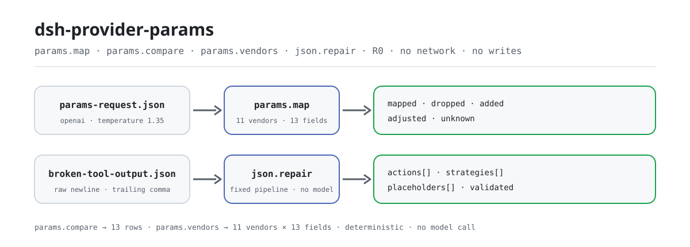

<div align="center">

<picture>
  <source media="(prefers-color-scheme: dark)" srcset="docs/assets/dsh-provider-params-flow-dark.svg">
  
</picture>

# dsh-provider-params

**11 LLM विक्रेताओं के बीच request parameters को मैप करें और टूटे JSON को तय नियमों से ठीक करें — हर कदम का ऑडिटेबल रिकॉर्ड रहता है।**

DeepSeek Harness के लिए रीड-ओनली टूलकिट: `params.map` / `params.compare` / `params.vendors` `temperature`, `top_p`, `max_tokens`, `stop`, `system` जैसे फ़ील्ड संभालते हैं, और `json.repair` trailing comma, कच्चे newline तथा truncation को ठीक करता है। कोई नेटवर्क नहीं, कोई फ़ाइल लेखन नहीं, कोई मॉडल कॉल नहीं।

[इंस्टॉल](#तीन-चरणों-में-शुरुआत) · [कॉन्फ़िगरेशन](#कॉन्फ़िगरेशन) · [FAQ](#faq) · [简体中文](README.md) · [English](README.en.md) · [Español](README.es.md) · [Português](README.pt.md) · [हिन्दी](README.hi.md)

[](LICENSE)
[](#संगतता)
[](https://www.npmjs.com/package/dsh-provider-params)
[](https://github.com/PerryLink/dsh-provider-params/actions/workflows/ci.yml)
[](#संगतता)

[](https://github.com/PerryLink/dsh-provider-params/stargazers)
[](https://www.npmjs.com/package/dsh-provider-params)

```sh
dsh plugin --profile <profile> add dsh-provider-params
```

</div>

<sub>समुदाय प्लगइन, DeepSeek से संबद्ध नहीं। एकमात्र रेपो: <https://github.com/PerryLink/dsh-provider-params>। स्थिति: alpha / सार्वजनिक सिंथेटिक / GA नहीं; चारों टूल R0 (रीड-ओनली) हैं।</sub>

## यह क्या है

`dsh-provider-params` 11 विक्रेताओं × 13 canonical फ़ील्ड की एक parameter तालिका रखता है, किसी request अंश को स्रोत विक्रेता के wire names से लक्ष्य विक्रेता के wire names में अनुवाद करता है, और हर मद पर बताता है कि क्या हुआ: `mapped` परिणाम है, `dropped` का अर्थ है कि लक्ष्य में इसका समतुल्य नहीं है, `added` का अर्थ है कि लक्ष्य में यह अनिवार्य है पर इनपुट ने नहीं दिया, `adjusted` का अर्थ है कि किसी प्रलेखित सीमा ने इसे काटा, और `unknown` का अर्थ है कि कुंजी पहचानी नहीं गई। `params.compare` दो विक्रेताओं के बीच 13 पंक्तियों का semantic diff देता है, और `params.vendors` फ़ील्ड सूची दिखाता है। `json.repair` टूटे JSON को text/structure रणनीतियों के तय क्रम से ठीक करता है और हर संपादन लौटाता है। चारों टूल केवल मेमोरी में गणना करते हैं: कोई नेटवर्क नहीं, कोई फ़ाइल लेखन नहीं, कोई मॉडल कॉल नहीं।

- **इनके लिए उपयुक्त**: OpenAI, Claude, Gemini, ERNIE, Qwen, DeepSeek, Mistral, Cohere, xAI, Groq और Azure OpenAI के बीच `temperature`, `top_p`, `max_tokens`, `stop`, `system` जैसे request फ़ील्ड ले जाना; यह जाँचना कि कोई parameter नाम बदला गया, छोड़ा गया, प्रलेखित सीमा में काटा गया, या लक्ष्य में अनिवार्य है पर स्रोत में नहीं है; किसी टूल के आउटपुट में कच्चे newline, trailing comma या कटी हुई string/container को पार्स करने से पहले ठीक करना।
- **इनके लिए उपयुक्त नहीं**: गुम व्यावसायिक डेटा का अनुमान लगाना या किसी विक्रेता का API कॉल करना — यह पैकेज कभी मान नहीं बनाता और इसमें नेटवर्क पथ नहीं है; किसी विक्रेता SDK, प्रमाणीकरण, streaming या पूरी request रचना को बदलना — यह केवल parameter अंश और text पर काम करता है।

## तीन चरणों में शुरुआत

1. **इंस्टॉल करें** (एक चैनल चुनें):

   ```sh
   # npm चैनल (प्रकाशित संस्करण)
   dsh plugin --profile <profile> add dsh-provider-params
   # tarball चैनल: इस रेपो में pnpm pack करें, फिर (prepublishOnly पहले बिल्ड करता है)
   dsh plugin --profile <profile> add ./dsh-provider-params-<version>.tgz
   ```

   npm पैकेज में पहले से बना `lib/` शामिल है; git स्रोत से इंस्टॉल करने के लिए पहले इस रेपो में `pnpm install && pnpm build` चलाएँ।

2. **न्यूनतम कॉन्फ़िग** (इंस्टॉल कमांड bundle patch अपने आप लगाता है; हाथ से लिखे प्रोफ़ाइल में यह एक पंक्ति डालें):

   ```yaml
   - insert:
       - id: dsh-provider-params
         name: 'dsh-provider-params'
   ```

   इस प्लगइन की कोई प्लगइन-स्तरीय कॉन्फ़िग कुंजी नहीं है; `cordis.patch.yml` केवल एक पंक्ति `insert` करता है, और सारा व्यवहार टूल कॉल के argument के रूप में जाता है।

3. **जाँचें कि माउंट हुआ**:

   ```sh
   dsh --profile <profile> --dump-config | grep dsh-provider-params
   node samples/quickstart/run.mjs
   ```

   नमूना क्रम से असली `== params.map ==` और `== json.repair ==` परिणाम छापता है। सेशन में सीधे यह भी कह सकते हैं:

   ```text
   बंडल किए गए नमूनों से मेरे OpenAI के temperature/top_p/max_tokens/stop को Anthropic parameters में बदलें, फिर मेरे टूटे JSON को ठीक करें जिसमें कच्चा newline है।
   ```

**अनइंस्टॉल**: `dsh plugin --profile <profile> remove dsh-provider-params` (या प्रोफ़ाइल patch से वह पंक्ति हटाएँ)।

## मुख्य क्षमताएँ

- **विक्रेताओं के बीच parameter मैपिंग** — `params.map` `from`, `to` और `params` ऑब्जेक्ट लेता है; फ़ील्ड स्रोत विक्रेता के wire names या canonical नामों में हो सकते हैं, और Google का `generationConfig` nested या dotted रूप स्वीकार करता है। यह `mapped` / `dropped` / `added` / `adjusted` / `unknown` लौटाता है, और `strict: true` अज्ञात कुंजियों को अस्वीकार करता है।
- **semantic अंतर ऑडिट** — `params.compare` हर फ़ील्ड को 13 पंक्तियों में `same / renamed / removed / added / absent` के रूप में वर्गीकृत करता है, साथ में दोनों ओर के wire names, अनिवार्यता, प्रलेखित सीमाएँ और नोट्स।
- **विक्रेता फ़ील्ड सूची** — `params.vendors` 11 विक्रेताओं और उनके 13 फ़ील्ड को नाम, समर्थन, अनिवार्यता, सीमा और नोट्स के साथ सूचीबद्ध करता है; वैकल्पिक `vendor` फ़िल्टर और `include_unsupported`।
- **नियतात्मक JSON रिपेयर** — `json.repair` `escapeRepair`, `trailingComma`, `truncationClosure` और `fieldCompletion` को तय क्रम में अधिकतम 1–64 चरणों तक चलाता है; `actions` हर संपादन दर्ज करता है और कोई व्यावसायिक मान नहीं बनाया जाता।
- **रीड-ओनली और ऑडिटेबल** — चारों टूल R0 हैं: कोई फ़ाइल लेखन नहीं, कोई मूल फ़ाइल परिवर्तन नहीं, कोई नेटवर्क नहीं, कोई मॉडल कॉल नहीं; आउटपुट केवल टूल परिणाम में रहता है।

### टूल सतह

टूल नाम स्थिर API हैं; चारों टूल रीड-ओनली, नियतात्मक और नेटवर्क-रहित हैं।

| टूल | उद्देश्य | जोखिम |
|---|---|---|
| `params.map` | स्रोत विक्रेता के request अंश को लक्ष्य विक्रेता में मैप करना और mapped/dropped/added/adjusted/unknown बताना | R0 |
| `params.compare` | दो विक्रेताओं के बीच 13 पंक्तियों की semantic parameter तुलना | R0 |
| `params.vendors` | 11 विक्रेताओं और उनके फ़ील्ड की सूची | R0 |
| `json.repair` | टूटे JSON को नियतात्मक रूप से ठीक करना और action सूची तथा placeholders लौटाना | R0 |

### इनपुट और आउटपुट

**इनपुट**

- `params.map`: `from`, `to` और JSON ऑब्जेक्ट `params`। फ़ील्ड स्रोत विक्रेता के wire names या canonical नामों में हो सकते हैं; Google का `generationConfig` nested या dotted हो सकता है। वैकल्पिक `strict: true` अज्ञात कुंजियों को अस्वीकार करता है।
- `params.compare`: दो विक्रेता ids।
- `params.vendors`: वैकल्पिक `vendor` फ़िल्टर और `include_unsupported`।
- `json.repair`: `text` (UTF-8, Markdown fences स्वीकार), वैकल्पिक `schema` (उपसमुच्चय: `type`, `properties`, `required`, `additionalProperties`, `items`, `enum`, `const`), चार वैकल्पिक strategy स्विच और वैकल्पिक `max_steps` 1–64।
- पैमाना: text मेमोरी में स्कैन होता है और host की प्रति टूल-कॉल argument सीमा तक बंधा है; पैकेज कोई फ़ाइल नहीं पढ़ता।
- शामिल नमूने: `samples/quickstart/input/params-request.json` और `samples/quickstart/input/broken-tool-output.json`।

**आउटपुट**

- `params.map`: लक्ष्य का wire ऑब्जेक्ट (`mapped`) तथा `dropped` (कोई समतुल्य नहीं), `added` (लक्ष्य में अनिवार्य पर इनपुट में नहीं, **मान के बिना**), `adjusted` (प्रलेखित सीमा में काटा गया) और `unknown` (अपहचानी कुंजियाँ)।
- `params.compare`: 13 semantic पंक्तियाँ `same / renamed / removed / added / absent` के रूप में, दोनों wire names, अनिवार्यता, प्रलेखित सीमाएँ और नोट्स के साथ।
- `params.vendors`: समर्थित विक्रेता और उनके फ़ील्ड (नाम, समर्थन, अनिवार्यता, सीमा, नोट्स)।
- `json.repair`: `ok`, `repaired` (text या `null`), `value`, `actions` (हर संपादन), `strategies`, `truncated`, `validated`, `placeholders`, `error`।
- डिस्क पर कुछ नहीं लिखा जाता और इनपुट फ़ाइल कभी नहीं बदलती। चारों टूल R0 (रीड-ओनली) हैं।

### उदाहरण

नमूने OpenAI → Anthropic parameter स्थानांतरण और कच्चे newline तथा trailing comma वाले टूल आउटपुट को कवर करते हैं:

```sh
node samples/quickstart/run.mjs
```

- [`params-request.json`](samples/quickstart/input/params-request.json) OpenAI के `temperature: 1.35` को Anthropic के `temperature: 1` में मैप करता है (प्रलेखित 0..1 कटौती, `adjusted` में 1.35 → 1 दर्ज), `stop` का नाम `stop_sequences` करता है, और `frequency_penalty` छोड़ता है क्योंकि Anthropic में इसका समतुल्य नहीं है। गोल्डन: [`params-mapped.json`](samples/quickstart/expected/params-mapped.json)।
- [`broken-tool-output.json`](samples/quickstart/input/broken-tool-output.json) के `note` में कच्चा newline और array के अंत में trailing comma है। रिपेयर `escape` action और `strip` action दर्ज करता है, `strategies: escapeRepair,trailingComma` के साथ। गोल्डन: [`json-repaired.json`](samples/quickstart/expected/json-repaired.json)।


*स्क्रीनशॉट असली `node --test test/params.test.mjs test/repair.test.mjs` आउटपुट से बनाया गया है (24/24 पास); कमांड, तिथि और हैश `screenshots.json` में दर्ज हैं। पूरी सूट में 4 फ़ाइलें और 35 केस हैं।*

### मैपिंग नियम

1. **केवल वही जो तालिका में लिखा है।** `supported: false` वाला सेल कारण के साथ छोड़ा जाता है, कभी भी मिलते-जुलते नाम में नहीं बदला जाता।
2. **अनिवार्य का अर्थ बनाया हुआ मान नहीं।** Anthropic का `max_tokens` अनिवार्य है; इनपुट में न हो तो वह `added` में आता है और `mapped` में कभी गढ़े हुए मान के साथ नहीं।
3. **कटौती केवल प्रलेखित सीमाओं पर।** ERNIE का `temperature` (0.01..1) और Anthropic का `temperature` (0..1) लागू होते हैं; दूसरे विक्रेताओं के नोट्स चुपचाप मान नहीं बदलते।
4. **टकराव वाले alias विफल होते हैं।** canonical नाम और स्रोत wire name अलग-अलग मानों के साथ देने पर `E_PARAMS_CONFLICT` लौटता है।
5. **Google nesting।** `generationConfig.*` nested ऑब्जेक्ट के रूप में लौटता है; nested इनपुट भी स्वीकार है।

### JSON रिपेयर नियम

पाइपलाइन तय है और कभी मॉडल नहीं बुलाती:

| रणनीति | करता है | नहीं करता |
|---|---|---|
| `escapeRepair` | strings के अंदर कच्चे control characters को escape करता है (`\n`, `\t`, `\uXXXX`) | strings के बाहर whitespace को नहीं छूता |
| `trailingComma` | `}` / `]` से ठीक पहले का comma हटाता है | असली separator नहीं हटाता |
| `truncationClosure` | कटी हुई string और खुले containers बंद करता है | गुम व्यावसायिक डेटा का अनुमान नहीं लगाता |
| `fieldCompletion` | मौजूद ऑब्जेक्ट के गुम अनिवार्य फ़ील्ड के लिए `null` लिखता है | गुम parent ऑब्जेक्ट नहीं बनाता, मान नहीं गढ़ता |

`json.repair` केवल object/array root स्वीकार करता है; अन्य root `E_JSON_NOT_CONTAINER` लौटाते हैं। schema उपसमुच्चय `type`, `properties`, `required`, `additionalProperties`, `items`, `enum`, `const` है। अन्य keywords `E_JSON_SCHEMA_UNSUPPORTED` के साथ अस्वीकार होते हैं, ताकि "जाँच हुई" का भ्रम न हो। repair के बाद भी schema का उल्लंघन करने वाला मान `E_JSON_SCHEMA_VIOLATION` के साथ विफल होता है, और मूल टूटा text कभी सफलता के रूप में नहीं लौटाया जाता।

## मापा गया डेटा

`node scripts/acceptance.mjs` सार्वजनिक/सिंथेटिक acceptance जाँचें दोबारा चलाता है; छहों पंक्तियाँ पास होती हैं, [`ACCEPTANCE.csv`](ACCEPTANCE.csv) से शब्दशः:

| req_id | मीट्रिक | सीमा | वास्तविक | परिणाम |
|---|---|---|---|---|
| PP-A01 | vendors listed | 11 | 11 | true |
| PP-A02 | canonical field count | 13 | 13 | true |
| PP-A03 | vendor-pair mappings clean | 121 | 121 | true |
| PP-A04 | deterministic repair strategies | 4 | 4 | true |
| PP-A05 | quickstart goldens match | 2 | 2 | true |
| PP-A06 | null placeholders reported | 1 | 1 | true |

हर acceptance पंक्ति `source=public/synthetic` और `counted=false` है; evidence hash `ACCEPTANCE.csv` में लिखा जाता है। ये सार्वजनिक/सिंथेटिक जाँचें हैं — कोई ग्राहक डेटा या ग्राहक साक्ष्य नहीं।

## कॉन्फ़िगरेशन

इस प्लगइन की कोई Schemastery `Config` कुंजी नहीं है — `cordis.patch.yml` केवल एक पंक्ति `insert` करता है (देखें "तीन चरणों में शुरुआत"), इसलिए ओवरराइड करने योग्य कोई प्लगइन-स्तरीय कुंजी नहीं है। हर समायोज्य व्यवहार टूल कॉल का argument है।

सबसे अधिक उपयोग किए जाने वाले parameters:

| Parameter | टूल | डिफ़ॉल्ट | अर्थ |
|---|---|---|---|
| `from` | `params.map` / `params.compare` | अनिवार्य | स्रोत विक्रेता id; 11 ids `params.vendors` में देखें |
| `to` | `params.map` / `params.compare` | अनिवार्य | लक्ष्य विक्रेता id |
| `params` | `params.map` | अनिवार्य | request अंश; स्रोत wire names या canonical नाम |
| `strict` | `params.map` | `false` | `true` अज्ञात कुंजियों को `E_PARAMS_UNKNOWN_PARAM` के साथ अस्वीकार करता है |
| `text` | `json.repair` | अनिवार्य | ठीक करने योग्य JSON text; Markdown fences स्वीकार |
| `max_steps` | `json.repair` | `8` | text/structure रिपेयर के scan/apply चक्र, 1–64 |

<details>
<summary>पूर्ण parameter तालिका (10 प्रविष्टियाँ)</summary>

| Parameter | टूल | डिफ़ॉल्ट | अर्थ |
|---|---|---|---|
| `from` | `params.map` / `params.compare` | अनिवार्य | स्रोत विक्रेता id |
| `to` | `params.map` / `params.compare` | अनिवार्य | लक्ष्य विक्रेता id |
| `params` | `params.map` | अनिवार्य | request अंश |
| `strict` | `params.map` | `false` | अज्ञात कुंजियाँ विफल हों या नहीं |
| `vendor` | `params.vendors` | सभी | केवल एक विक्रेता; case-insensitive |
| `include_unsupported` | `params.vendors` | `false` | बिना समतुल्य वाले फ़ील्ड शामिल करें |
| `text` | `json.repair` | अनिवार्य | ठीक करने योग्य JSON text |
| `schema` | `json.repair` | कोई नहीं | समर्थित उपसमुच्चय में schema; पूर्णता और अंतिम जाँच के लिए |
| `strategies` | `json.repair` | चारों चालू | `escape_repair` / `trailing_comma` / `truncation_closure` / `field_completion` |
| `max_steps` | `json.repair` | `8` | 1–64 का पूर्णांक |

</details>

## FAQ

<details>
<summary>इंस्टॉल होता है पर टूल नहीं दिखते। अब क्या?</summary>

जाँचें कि प्रोफ़ाइल ने यह पैकेज लोड किया: `dsh --profile <profile> --dump-config | grep dsh-provider-params`। प्लगइन केवल `tools` सेवा पर निर्भर है; host उसे न दे तो माउंट विफल होता है। त्रुटि कोड और निदान कदम [`TROUBLESHOOTING.md`](TROUBLESHOOTING.md) में हैं।

</details>

<details>
<summary>मैप किया गया परिणाम अपेक्षा से अलग है।</summary>

पहले `dropped` और `adjusted` देखें: लक्ष्य में समतुल्य नहीं हो सकता, या किसी प्रलेखित सीमा ने मान काट दिया हो सकता है। दोनों wire names और सीमाएँ देखने के लिए `params.compare` चलाएँ। अज्ञात कुंजियाँ `unknown` में आती हैं; वे कभी चुपचाप परिणाम में नहीं घुसतीं।

</details>

<details>
<summary>क्या यह मेरी फ़ाइलें संसाधित कर सकता है?</summary>

सीधे नहीं। JSON text को `json.repair.text` के रूप में और parameter ऑब्जेक्ट को `params.map.params` के रूप में दें। यह डिस्क नहीं पढ़ता, नेटवर्क नहीं बुलाता और मॉडल नहीं बुलाता।

</details>

<details>
<summary>क्या यह गुम फ़ील्ड गढ़ता है?</summary>

नहीं। `added` लक्ष्य के अनिवार्य फ़ील्ड बिना मान के बताता है। अनिवार्य-फ़ील्ड पूर्णता केवल `null` placeholders लिखती है और उनके paths `placeholders` में बताती है; असली मान कॉलर को देने होते हैं।

</details>

<details>
<summary>प्रकाशित <code>dsh-translate</code> से इसका क्या संबंध है?</summary>

यह पैकेज `dsh-translate` के विक्रेता parameter मैपिंग और नियतात्मक JSON रिपेयर को नई पैकेज संरचना में फिर से लिखता है, नए टेस्ट और दस्तावेज़ के साथ; `dsh-translate` जैसा है वैसा रहता है। दोनों PerryLink का Apache-2.0 कोड हैं।

</details>

## सुरक्षा सीमाएँ

- **रीड-ओनली, कभी स्थायी नहीं।** चारों टूल कोई फ़ाइल नहीं लिखते और मूल फ़ाइलें नहीं बदलते; आउटपुट केवल टूल परिणाम में रहता है और कॉल के बाद कोई स्थिति नहीं बचती।
- **कोई नेटवर्क नहीं, कोई मॉडल कॉल नहीं।** स्रोत में कोई HTTP / DNS / WebSocket कॉल या मॉडल-कॉल पथ नहीं है; `dsh.demo.network` `false` है।
- **कोई गढ़ा हुआ मान नहीं।** `added` लक्ष्य के अनिवार्य पर गुम फ़ील्ड बिना मान के बताता है; `json.repair` की field completion केवल `null` placeholders लिखती है, उनके paths `placeholders` में बताती है और असली मान कॉलर पर छोड़ती है।
- **सीमाएँ केवल प्रलेखित होने पर काटती हैं।** ERNIE का `temperature` (0.01..1) और Anthropic का `temperature` (0..1) ही स्पष्ट कटौती हैं; दूसरे विक्रेताओं के नोट्स कभी मान नहीं बदलते।
- **विफलता बंद दिशा में।** असमर्थित schema keywords, schema का उल्लंघन करता मान, अज्ञात strategy नाम और सीमा से बाहर `max_steps` — सब ज़ोर से विफल होते हैं; मूल टूटा text कभी सफलता के रूप में नहीं बताया जाता।

### अनुमतियाँ और डेटा

- **पढ़ता है**: कॉलर द्वारा दिया गया parameter ऑब्जेक्ट या JSON text; कोई अन्य निर्देशिका नहीं।
- **लिखता है**: कुछ नहीं (R0, कोई फ़ाइल लेखन नहीं, मूल फ़ाइलें अछूती)।
- **नेटवर्क**: नहीं (कोई request पथ नहीं और कोई नेटवर्क स्विच नहीं)।
- **बाहरी सिस्टम**: कोई नहीं।

### त्रुटि कोड

| कोड | अर्थ | अगला कदम |
|---|---|---|
| `E_PARAMS_UNKNOWN_VENDOR` | विक्रेता id तालिका में नहीं है | 11 ids देखने के लिए `params.vendors` चलाएँ |
| `E_PARAMS_UNKNOWN_PARAM` | `strict: true` के साथ अज्ञात कुंजी | कुंजी हटाएँ या `strict: false` करें |
| `E_PARAMS_CONFLICT` | एक ही parameter दो रूपों में अलग-अलग मान के साथ | एक ही रूप रखें |
| `E_JSON_NOT_CONTAINER` | text का root object या array नहीं है | टूल आउटपुट का `{...}` / `[...]` अंश दें |
| `E_JSON_UNREPAIRABLE` | चालू strategies के साथ भी text पार्स नहीं होता | strategies बदलकर फिर आज़माएँ, या upstream से पूरा JSON माँगें |
| `E_JSON_SCHEMA_VIOLATION` | repair के बाद भी मान schema का उल्लंघन करता है | `error.message` का path देखें और असली मान दें |
| `E_JSON_SCHEMA_UNSUPPORTED` | schema असमर्थित keyword इस्तेमाल करता है | समर्थित उपसमुच्चय इस्तेमाल करें |

अधिक निदान कदम [`TROUBLESHOOTING.md`](TROUBLESHOOTING.md) में।

## ज्ञात सीमाएँ

- **तालिका स्थिर दस्तावेज़ डेटा है।** 11 विक्रेता × 13 canonical फ़ील्ड सार्वजनिक API दस्तावेज़ से संगठित हैं; तीन `ported` विक्रेता (OpenAI, ERNIE, Qwen) GPT-Rosetta-Stone से हैं और `extended` पंक्तियाँ हर विक्रेता के सार्वजनिक API संदर्भ का पालन करती हैं। लाइव विक्रेता API replay नहीं किया गया, इसलिए विक्रेता बदलने पर आधिकारिक दस्तावेज़ ही मान्य है।
- **केवल 13 canonical फ़ील्ड कवर हैं।** विक्रेता-विशिष्ट अतिरिक्त फ़ील्ड मॉडल नहीं किए गए; वे मैपिंग में `unknown` के रूप में आते हैं या तुलना तालिका में नहीं दिखते।
- **JSON रिपेयर text/structure heuristic है।** यह व्यावसायिक अर्थ नहीं समझता और फिर भी `E_JSON_UNREPAIRABLE` लौटा सकता है; `schema` केवल घोषित उपसमुच्चय का समर्थन करता है, `oneOf`, `$ref`, `allOf` जैसे keywords का नहीं।
- **यह विक्रेता SDK नहीं है।** प्रमाणीकरण, streaming, retries या पूरी request रचना को नहीं बदलता; केवल parameter अंश और text संभालता है।
- **फ़ाइल नहीं पढ़ता।** JSON को `text` के रूप में देना होता है; बड़ा text host की प्रति टूल-कॉल argument सीमा तक बंधा है।
- **alpha / सार्वजनिक सिंथेटिक / GA नहीं।** केवल सार्वजनिक या सिंथेटिक नमूनों से सत्यापित; कोई ग्राहक डेटा या ग्राहक साक्ष्य नहीं, और उत्पादन-तैयारी का दावा नहीं।

## संगतता

| सतह | स्थिति |
|---|---|
| Harness | `dsh >=0.2.1-rc.3 <0.4.0` (`package.json` में `engines.dsh`) |
| Node | `>=24.9.0 <25` (`package.json` में `engines.node`) |
| प्लेटफ़ॉर्म | सभी; केवल मेमोरी में गणना |
| डेटा | कोई नेटवर्क नहीं, कोई मॉडल कॉल नहीं, कोई अपलोड नहीं |
| निर्भरताएँ | `@deepseek-ai/cordis`, `@deepseek-ai/dsh-tools` (वैकल्पिक peer); कोई नई runtime निर्भरता नहीं |
| टूल | चारों टूल R0 (रीड-ओनली) |

## इकोसिस्टम और गुणवत्ता

- [PerryLink प्लगइन सूची](https://perrylink.github.io/dsh-plugins/): इस पैकेज का पृष्ठ [dsh-provider-params](https://perrylink.github.io/dsh-plugins/packages/dsh-provider-params.html) (संस्करण और npm लिंक)
- [प्लगइन परिवार का अवलोकन](https://perrylink.github.io/dsh-plugins/family.html) (सभी Apache-2.0)
- [npm पैकेज पृष्ठ](https://www.npmjs.com/package/dsh-provider-params) (संस्करण और डाउनलोड)

## विकास

```sh
pnpm install
pnpm build
pnpm lint
pnpm typecheck
node --test test/*.test.mjs
node scripts/gate.mjs
```

`node scripts/gate.mjs` lint, `tsc --noEmit`, build, acceptance स्क्रिप्ट और सभी टेस्ट चलाता है। Acceptance पंक्तियाँ `ACCEPTANCE.csv` में public/synthetic, `counted=false` के रूप में लिखी जाती हैं।

वर्तमान संस्करण `0.1.0` (`package.json` के अनुसार); सूट में 4 फ़ाइलें और 35 केस हैं। संरचना:

| पथ | सामग्री |
|---|---|
| `src/core/` | शुद्ध-फ़ंक्शन कोर: `rosetta` (तालिका), `mapping`, `repair`, `json`, `errors`; Cordis पर निर्भरता नहीं |
| `src/plugin/` | `index.ts` (apply) और `tools.ts` (चारों टूल परिभाषाएँ) |
| `test/` | `params` / `repair` / `plugin-smoke` / `samples` की `node --test` सूट |
| `samples/quickstart/` | सिंथेटिक इनपुट, गोल्डन आउटपुट और `run.mjs` |
| `scripts/` | `acceptance.mjs`, `gate.mjs`, `lint.mjs`, `gen-readme-assets.py` |
| `docs/assets/` | README चित्र (light/dark hero SVG, quickstart स्क्रीनशॉट) |

README के चित्र [`scripts/gen-readme-assets.py`](scripts/gen-readme-assets.py) से क्रमादेशित रूप से बनते हैं (Python + Pillow; light/dark SVG फ़्लो पाँचों भाषाओं में साझा) और दोबारा चलाए जा सकते हैं:

```sh
python scripts/gen-readme-assets.py
```

Topics: `deepseek-harness`, `dsh`, `dsh-plugin`, `provider`, `parameter-mapping`, `json-repair`, `llm-api`, `perrylink`

## परिवार और आभार

यह परियोजना [PerryLink](https://github.com/PerryLink) के DeepSeek Harness प्लगइन परिवार का हिस्सा है (सभी Apache-2.0)। अगर यह उपयोगी है, तो **एक star अगले व्यक्ति को इसे खोजने में मदद करता है** — इसके पीछे कोई सुविधा नहीं छिपी है।

- [@PerryLink](https://github.com/PerryLink) — निर्माता और अनुरक्षक: 11 विक्रेताओं की parameter तालिका, चारों रीड-ओनली टूल, quickstart नमूना और acceptance सूट, तथा पाँच-भाषा दस्तावेज़।
- तीन `ported` पंक्तियाँ PerryLink के GPT-Rosetta-Stone (Apache-2.0) से आती हैं; यह पैकेज `dsh-translate` के विक्रेता parameter मैपिंग और नियतात्मक JSON रिपेयर को नई संरचना में फिर से लिखता है।

<details>
<summary>सभी प्लगइन खोलें</summary>

| प्लगइन | स्थिति |
|---|---|
| **[dsh-aqua-input-check](https://github.com/PerryLink/dsh-aqua-input-check)** |  |
| **[dsh-archive-check](https://github.com/PerryLink/dsh-archive-check)** |  |
| **[dsh-auto-review](https://github.com/PerryLink/dsh-auto-review)** |  |
| **[dsh-autotier](https://github.com/PerryLink/dsh-autotier)** | 🧊 फ़्रोज़न — रेपो README देखें |
| **[dsh-bid-ca-precheck](https://github.com/PerryLink/dsh-bid-ca-precheck)** |  |
| **[dsh-bid-qual-check](https://github.com/PerryLink/dsh-bid-qual-check)** |  |
| **[dsh-cert-mcp](https://github.com/PerryLink/dsh-cert-mcp)** | 🧊 फ़्रोज़न — रेपो README देखें |
| **[dsh-checkpoint-rewind](https://github.com/PerryLink/dsh-checkpoint-rewind)** |  |
| **[dsh-click](https://github.com/PerryLink/dsh-click)** |  |
| **[dsh-composer-history](https://github.com/PerryLink/dsh-composer-history)** |  |
| **[dsh-contract-stance](https://github.com/PerryLink/dsh-contract-stance)** |  |
| **[dsh-customs-doc-check](https://github.com/PerryLink/dsh-customs-doc-check)** |  |
| **[dsh-data-quality](https://github.com/PerryLink/dsh-data-quality)** |  |
| **[dsh-demurrage-ledger](https://github.com/PerryLink/dsh-demurrage-ledger)** |  |
| **[dsh-doublecheck](https://github.com/PerryLink/dsh-doublecheck)** |  |
| **[dsh-drill-script-check](https://github.com/PerryLink/dsh-drill-script-check)** |  |
| **[dsh-eia-guide-check](https://github.com/PerryLink/dsh-eia-guide-check)** |  |
| **[dsh-emergency-plan](https://github.com/PerryLink/dsh-emergency-plan)** |  |
| **[dsh-essay-rubric-check](https://github.com/PerryLink/dsh-essay-rubric-check)** |  |
| **[dsh-evidence-check](https://github.com/PerryLink/dsh-evidence-check)** |  |
| **[dsh-export-ctl-check](https://github.com/PerryLink/dsh-export-ctl-check)** |  |
| **[dsh-fast](https://github.com/PerryLink/dsh-fast)** |  |
| **[dsh-fmea-table-check](https://github.com/PerryLink/dsh-fmea-table-check)** |  |
| **[dsh-forecast-penalty](https://github.com/PerryLink/dsh-forecast-penalty)** |  |
| **[dsh-fund-research](https://github.com/PerryLink/dsh-fund-research)** |  |
| **[dsh-github](https://github.com/PerryLink/dsh-github)** |  |
| **[dsh-gongwen-flow-check](https://github.com/PerryLink/dsh-gongwen-flow-check)** |  |
| **[dsh-gongwen-word-check](https://github.com/PerryLink/dsh-gongwen-word-check)** |  |
| **[dsh-guard-plan-qc](https://github.com/PerryLink/dsh-guard-plan-qc)** |  |
| **[dsh-hazchem-check](https://github.com/PerryLink/dsh-hazchem-check)** |  |
| **[dsh-hazplan-check](https://github.com/PerryLink/dsh-hazplan-check)** |  |
| **[dsh-hidden-risk-map](https://github.com/PerryLink/dsh-hidden-risk-map)** |  |
| **[dsh-hs-classify](https://github.com/PerryLink/dsh-hs-classify)** |  |
| **[dsh-icd-rule-check](https://github.com/PerryLink/dsh-icd-rule-check)** |  |
| **[dsh-industry-research](https://github.com/PerryLink/dsh-industry-research)** |  |
| **[dsh-lawcite-adapter](https://github.com/PerryLink/dsh-lawcite-adapter)** |  |
| **[dsh-laya](https://github.com/PerryLink/dsh-laya)** |  |
| **[dsh-lc-doc-check](https://github.com/PerryLink/dsh-lc-doc-check)** |  |
| **[dsh-learning-gap-check](https://github.com/PerryLink/dsh-learning-gap-check)** |  |
| **[dsh-library](https://github.com/PerryLink/dsh-library)** |  |
| **[dsh-local-ai](https://github.com/PerryLink/dsh-local-ai)** |  |
| **[dsh-lsp-actions](https://github.com/PerryLink/dsh-lsp-actions)** |  |
| **[dsh-mask](https://github.com/PerryLink/dsh-mask)** |  |
| **[dsh-mcp-panel](https://github.com/PerryLink/dsh-mcp-panel)** |  |
| **[dsh-medrec-qc](https://github.com/PerryLink/dsh-medrec-qc)** |  |
| **[dsh-memento](https://github.com/PerryLink/dsh-memento)** |  |
| **[dsh-nsfc-form-check](https://github.com/PerryLink/dsh-nsfc-form-check)** |  |
| **[dsh-nurse-record-check](https://github.com/PerryLink/dsh-nurse-record-check)** |  |
| **[dsh-observe](https://github.com/PerryLink/dsh-observe)** |  |
| **[dsh-origin-rvc-check](https://github.com/PerryLink/dsh-origin-rvc-check)** |  |
| **[dsh-ota-review-check](https://github.com/PerryLink/dsh-ota-review-check)** |  |
| **[dsh-output-styles](https://github.com/PerryLink/dsh-output-styles)** |  |
| **[dsh-paper-doc-adapter](https://github.com/PerryLink/dsh-paper-doc-adapter)** |  |
| **[dsh-permission-rules](https://github.com/PerryLink/dsh-permission-rules)** |  |
| **[dsh-permit-report-check](https://github.com/PerryLink/dsh-permit-report-check)** |  |
| **[dsh-pipeline-check](https://github.com/PerryLink/dsh-pipeline-check)** |  |
| **[dsh-pleading-draft](https://github.com/PerryLink/dsh-pleading-draft)** |  |
| **[dsh-plugin-doctor](https://github.com/PerryLink/dsh-plugin-doctor)** | 🚫 रिटायर्ड (रेपो संग्रहीत) |
| **[dsh-plugin-guide](https://github.com/PerryLink/dsh-plugin-guide)** |  |
| **[dsh-plugin-kit](https://github.com/PerryLink/dsh-plugin-kit)** | 🚫 रिटायर्ड (रेपो संग्रहीत) |
| **[dsh-plugin-upgrade](https://github.com/PerryLink/dsh-plugin-upgrade)** | 🚫 रिटायर्ड (रेपो संग्रहीत) |
| **[dsh-policy-brief-draft](https://github.com/PerryLink/dsh-policy-brief-draft)** |  |
| **[dsh-power-loss-split](https://github.com/PerryLink/dsh-power-loss-split)** |  |
| **[dsh-power-ticket-check](https://github.com/PerryLink/dsh-power-ticket-check)** |  |
| **[dsh-ppap-check](https://github.com/PerryLink/dsh-ppap-check)** |  |
| **[dsh-protest-deadline](https://github.com/PerryLink/dsh-protest-deadline)** |  |
| **[dsh-railway-window](https://github.com/PerryLink/dsh-railway-window)** |  |
| **[dsh-repair-order-qc](https://github.com/PerryLink/dsh-repair-order-qc)** |  |
| **[dsh-research-report](https://github.com/PerryLink/dsh-research-report)** |  |
| **[dsh-review-reply-check](https://github.com/PerryLink/dsh-review-reply-check)** |  |
| **[dsh-rulefile-check](https://github.com/PerryLink/dsh-rulefile-check)** |  |
| **[dsh-safety-brief-check](https://github.com/PerryLink/dsh-safety-brief-check)** |  |
| **[dsh-score](https://github.com/PerryLink/dsh-score)** |  |
| **[dsh-session-sync](https://github.com/PerryLink/dsh-session-sync)** |  |
| **[dsh-site-log-check](https://github.com/PerryLink/dsh-site-log-check)** |  |
| **[dsh-skill-pack-security](https://github.com/PerryLink/dsh-skill-pack-security)** |  |
| **[dsh-soe-decision-check](https://github.com/PerryLink/dsh-soe-decision-check)** |  |
| **[dsh-soilwater-check](https://github.com/PerryLink/dsh-soilwater-check)** |  |
| **[dsh-sop-sync-check](https://github.com/PerryLink/dsh-sop-sync-check)** |  |
| **[dsh-spc-gbt-adapter](https://github.com/PerryLink/dsh-spc-gbt-adapter)** |  |
| **[dsh-talk](https://github.com/PerryLink/dsh-talk)** |  |
| **[dsh-tender-extract](https://github.com/PerryLink/dsh-tender-extract)** |  |
| **[dsh-tender-matrix](https://github.com/PerryLink/dsh-tender-matrix)** |  |
| **[dsh-test-drive](https://github.com/PerryLink/dsh-test-drive)** |  |
| **[dsh-ticktick](https://github.com/PerryLink/dsh-ticktick)** | 🚫 रिटायर्ड (रेपो संग्रहीत) |
| **[dsh-translate](https://github.com/PerryLink/dsh-translate)** |  |
| **[dsh-warranty-calc](https://github.com/PerryLink/dsh-warranty-calc)** |  |
| **[dsh-budget](https://github.com/PerryLink/dsh-budget)** | 🧊 फ़्रोज़न — रेपो README देखें |
| **[dsh-claude-move](https://github.com/PerryLink/dsh-claude-move)** | 🧊 फ़्रोज़न — रेपो README देखें |
| **[dsh-defend](https://github.com/PerryLink/dsh-defend)** | 🧊 फ़्रोज़न — रेपो README देखें |
| **[dsh-draw](https://github.com/PerryLink/dsh-draw)** | 🧊 फ़्रोज़न — रेपो README देखें |
| **[dsh-reach](https://github.com/PerryLink/dsh-reach)** | 🧊 फ़्रोज़न — रेपो README देखें |
| **[dsh-background-agents](https://github.com/PerryLink/dsh-background-agents)** | 🚫 रिटायर्ड (रेपो संग्रहीत) |
| **[dsh-session-pin](https://github.com/PerryLink/dsh-session-pin)** | 🚫 रिटायर्ड (रेपो संग्रहीत) |
| **[dsh-team-rooms](https://github.com/PerryLink/dsh-team-rooms)** | 🚫 रिटायर्ड (रेपो संग्रहीत) |

</details>

## लाइसेंस

[LICENSE](LICENSE) (Apache License 2.0) © 2026 dsh-provider-params contributors

<p align="center"><sub>Apache-2.0 · समुदाय प्लगइन, DeepSeek से संबद्ध नहीं।</sub></p>
