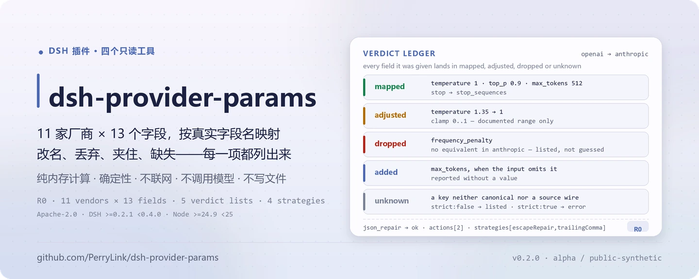
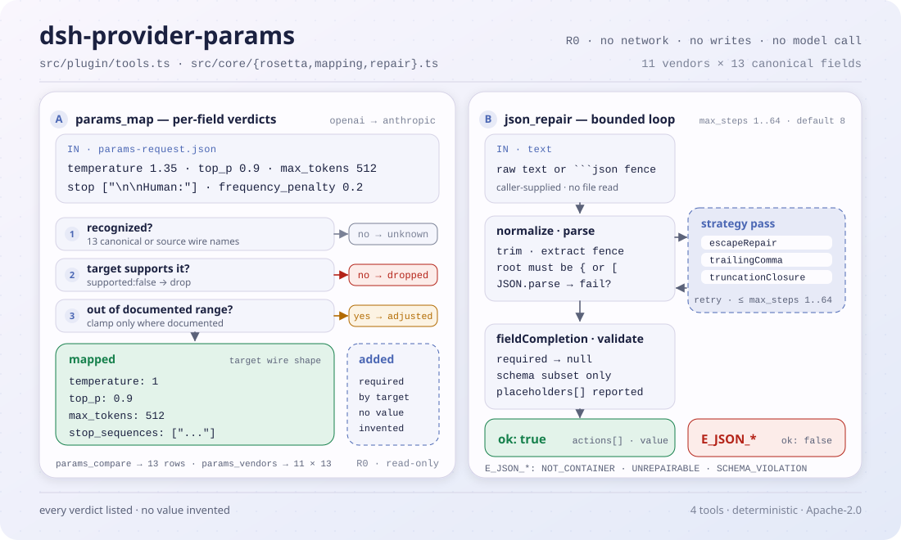

<div align="center">

<picture>
  <source media="(prefers-color-scheme: dark)" srcset="docs/assets/dsh-provider-params-hero-zh-dark.webp">
  
</picture>

# dsh-provider-params

**把 11 家模型厂商的请求参数互相映射，再把坏掉的 JSON 按固定规则修好——每一步都留下可审计的记录。**

面向 DeepSeek Harness 的只读工具包：`params_map` / `params_compare` / `params_vendors` 处理 `temperature`、`top_p`、`max_tokens`、`stop`、`system` 等字段，`json_repair` 处理尾逗号、裸换行与截断；不联网、不写文件、不调用模型。

[安装](#三步上手) · [配置](#配置) · [FAQ](#faq) · [简体中文](README.md) · [English](README.en.md) · [Español](README.es.md) · [Português](README.pt.md) · [हिन्दी](README.hi.md)

[](LICENSE)
[](#兼容性)
[](https://www.npmjs.com/package/dsh-provider-params)
[](https://github.com/PerryLink/dsh-provider-params/actions/workflows/ci.yml)
[](#兼容性)

[](https://github.com/PerryLink/dsh-provider-params/stargazers)
[](https://www.npmjs.com/package/dsh-provider-params)

```sh
dsh plugin --profile <profile> add dsh-provider-params
```

</div>

<sub>社区插件，与 DeepSeek 官方无关。唯一仓库：<https://github.com/PerryLink/dsh-provider-params>。状态：alpha / 公开合成 / 非 GA；四个工具均为 R0（只读）。</sub>

## 它是什么

`dsh-provider-params` 维护一张 11 家厂商 × 13 个 canonical 字段的参数表，把一段请求参数从源厂商的 wire name 翻译成目标厂商的 wire name，并逐项报告发生了什么：`mapped` 是结果，`dropped` 是目标没有等价字段，`added` 是目标必填但输入没给，`adjusted` 是被文档范围夹住，`unknown` 是认不出的键。`params_compare` 给出两家厂商的 13 行语义差异，`params_vendors` 列出字段目录。`json_repair` 用固定顺序的文本/结构策略修好坏 JSON，返回每一次编辑。四个工具都是纯内存计算，不联网、不写文件、不调用模型。

- **适合**：在 OpenAI、Claude、Gemini、ERNIE、Qwen、DeepSeek、Mistral、Cohere、xAI、Groq、Azure OpenAI 之间迁移 `temperature`、`top_p`、`max_tokens`、`stop`、`system` 等请求字段；审计某个参数到底是被改名、丢弃、夹到范围内，还是目标必填但源请求没给；工具输出带尾逗号、未转义换行或被截断，需要先确定性修好再解析。
- **不适合**：让模型“猜”缺失的业务字段，或调用厂商 API——本包不联网、不调用模型，也不会编造值；替代厂商 SDK、鉴权、流式调用或完整的请求构造——它只处理参数片段和文本。

<picture>
  <source media="(prefers-color-scheme: dark)" srcset="docs/assets/dsh-provider-params-flow-v5-dark.svg">
  
</picture>

## 三步上手

1. **安装**（二选一）：

   ```sh
   # npm 通道（已发布版本）
   dsh plugin --profile <profile> add dsh-provider-params
   # tarball 通道：本仓库 pnpm pack 后（prepublishOnly 会先构建）
   dsh plugin --profile <profile> add ./dsh-provider-params-<version>.tgz
   ```

   npm 包已包含构建产物 `lib/`；从 git 源码安装需要先在本仓库执行 `pnpm install && pnpm build`。

2. **最小配置**（安装命令已自动应用 bundle patch；手写 profile 时照抄这一行即可）：

   ```yaml
   - insert:
       - id: dsh-provider-params
         name: 'dsh-provider-params'
   ```

   本插件没有插件级配置键，`cordis.patch.yml` 只 `insert` 一行；所有行为都在调用工具时以参数传入。

3. **验证已生效**：

   ```sh
   dsh --profile <profile> --dump-config | grep dsh-provider-params
   node samples/quickstart/run.mjs
   ```

   样例会依次打印 `== params_map ==` 与 `== json_repair ==` 的真实结果。在会话里也可以直接说：

   > 用自带样例把我这段 OpenAI 的 temperature/top_p/max_tokens/stop 转成 Anthropic 参数，再把我那段带换行的坏 JSON 修好

**卸载**：`dsh plugin --profile <profile> remove dsh-provider-params`（或从 profile patch 删掉该行）。

## 核心能力

- **跨厂商参数映射** —— `params_map` 接收 `from`、`to` 与一段 `params`，字段可以用源厂商 wire name，也可以直接用 canonical 名；Google 的 `generationConfig` 支持嵌套与点号两种写法。结果同时给出 `mapped` / `dropped` / `added` / `adjusted` / `unknown`，`strict: true` 时未知键直接报错。
- **语义差异审计** —— `params_compare` 对两家厂商逐字段给出 `same / renamed / removed / added / absent`，共 13 行，附带两端的 wire name、是否必填、文档范围与备注。
- **厂商字段目录** —— `params_vendors` 列出 11 家厂商及其 13 个字段的名称、支持标记、必填标记、范围与备注；可选 `vendor` 过滤与 `include_unsupported`。
- **确定性 JSON 修复** —— `json_repair` 按固定顺序执行 `escapeRepair`、`trailingComma`、`truncationClosure`、`fieldCompletion`，最多 1–64 步；返回 `actions` 里每一次编辑，绝不编造业务值。
- **只读与可审计** —— 四个工具全部是 R0：不写文件、不改原文件、不联网、不调用模型；输出只落在工具结果里。

### 工具面

工具名是稳定 API；四个工具都只读、确定性、无网络。

| 工具 | 用途 | 风险 |
|---|---|---|
| `params_map` | 把源厂商请求片段映射到目标厂商，返回 mapped/dropped/added/adjusted/unknown | R0 |
| `params_compare` | 两个厂商的 13 行参数语义差异表 | R0 |
| `params_vendors` | 列出 11 家厂商及其字段 | R0 |
| `json_repair` | 确定性修复坏 JSON，返回动作列表与占位符 | R0 |

### 输入与输出

**输入**

- `params_map`：`from`、`to` 与 JSON 对象 `params`；字段可用源厂商 wire name 或 canonical 名，Google 的 `generationConfig` 可嵌套也可点号；可选 `strict: true` 让未知键直接报错。
- `params_compare`：`from`、`to` 两个厂商 id。
- `params_vendors`：可选 `vendor` 过滤，可选 `include_unsupported: true` 显示无等价字段。
- `json_repair`：`text`（UTF-8 字符串，可带 Markdown 代码围栏）；可选 `schema`（仅支持 `type`、`properties`、`required`、`additionalProperties`、`items`、`enum`、`const`）；可选 `strategies` 四个开关；可选 `max_steps`（1–64）。
- 规模：文本在内存中扫描，受宿主单次工具调用的参数上限约束；本包不读取任何文件。
- 自带样例：`samples/quickstart/input/params-request.json` 与 `samples/quickstart/input/broken-tool-output.json`。

**输出**

- `params_map`：目标厂商的 wire 形状（`mapped`），以及 `dropped`（目标无等价）、`added`（目标必填但输入未给，**不含值**）、`adjusted`（被文档化范围夹住）、`unknown`（无法识别的键）四个列表。
- `params_compare`：13 行语义差异表，每行标记 `same / renamed / removed / added / absent`，并给出两端的 wire name、是否必填、文档范围与备注。
- `params_vendors`：支持的厂商及其字段（名称、是否支持、是否必填、范围、备注）。
- `json_repair`：`ok`、`repaired`（文本或 `null`）、`value`、`actions`（每一次编辑）、`strategies`、`truncated`、`validated`、`placeholders`、`error`。
- 输出只落在工具结果里；**不写文件、不改原文件、不联网**。四个工具都是 R0（只读）。

### 示例

样例使用 OpenAI → Anthropic 的参数迁移与一段带裸换行、尾逗号的工具输出：

```sh
node samples/quickstart/run.mjs
```

- [`params-request.json`](samples/quickstart/input/params-request.json) 的 `temperature` 是 1.35，目标 Anthropic 的文档范围是 0..1，所以结果为 `temperature: 1`，并在 `adjusted` 里记录 1.35 → 1；`stop` 改名为 `stop_sequences`；`frequency_penalty` 在 Anthropic 无等价，进入 `dropped`。金标在 [`params-mapped.json`](samples/quickstart/expected/params-mapped.json)。
- [`broken-tool-output.json`](samples/quickstart/input/broken-tool-output.json) 的 `note` 里有真实换行，数组末尾还有尾逗号；修复后 `ok: true`，`actions` 依次记录 `escape` 与 `strip`，`strategies` 为 `escapeRepair,trailingComma`。金标在 [`json-repaired.json`](samples/quickstart/expected/json-repaired.json)。


*截图由真实 `node --test test/params.test.mjs test/repair.test.mjs` 输出渲染（24/24 通过）；命令、时间与输出哈希记录在 `screenshots.json`。完整套件为 5 个测试文件、36 个用例。*

### 映射规则

1. **只做表里写过的事。** `supported: false` 的字段进入 `dropped`，不会猜一个看起来合理的名字。
2. **必填不等于自动补值。** Anthropic 的 `max_tokens` 是必填；输入没给时只进 `added`，`mapped` 里不会出现凭空的值。
3. **范围只在文档写明时夹。** 目前显式 clamp 的是 ERNIE `temperature`（0.01..1）与 Anthropic `temperature`（0..1）；其余厂商即使备注了范围，也不擅自改值。
4. **别名冲突要报错。** canonical 名和源厂商 wire name 同时给出且值不同，返回 `E_PARAMS_CONFLICT`。
5. **Google 嵌套。** `generationConfig.*` 在输出中还原为嵌套对象；输入也接受嵌套对象。

### JSON 修复规则

按固定顺序执行，全部是文本/结构操作，不调用模型：

| 策略 | 做什么 | 不做什么 |
|---|---|---|
| `escapeRepair` | 把字符串里的原始控制字符转成 `\n`、`\t`、`\uXXXX` 等 | 不改字符串以外的空白 |
| `trailingComma` | 删除 `}` / `]` 前的尾逗号 | 不删除正常分隔符 |
| `truncationClosure` | 补齐被截断的字符串与容器 | 不把缺失内容猜成业务数据 |
| `fieldCompletion` | 给已存在对象的缺失必填字段写 `null` | 不创建缺失的父对象，不编造值 |

`json_repair` 只接受 `{` 或 `[` 根；其他根返回 `E_JSON_NOT_CONTAINER`。`schema` 只支持 `type`、`properties`、`required`、`additionalProperties`、`items`、`enum`、`const`；其他关键字会以 `E_JSON_SCHEMA_UNSUPPORTED` 拒绝，避免“看起来校验了其实没校验”。修复后仍违反 schema 的值会被拒绝（`E_JSON_SCHEMA_VIOLATION`），不会把原始坏文本当成功返回。

## 实测数据

`node scripts/acceptance.mjs` 重跑公开/合成验收；六行全部通过，逐字引自 [`ACCEPTANCE.csv`](ACCEPTANCE.csv)：

| req_id | 指标 | 阈值 | 实测 | 结果 |
|---|---|---|---|---|
| PP-A01 | vendors listed | 11 | 11 | true |
| PP-A02 | canonical field count | 13 | 13 | true |
| PP-A03 | vendor-pair mappings clean | 121 | 121 | true |
| PP-A04 | deterministic repair strategies | 4 | 4 | true |
| PP-A05 | quickstart goldens match | 2 | 2 | true |
| PP-A06 | null placeholders reported | 1 | 1 | true |

全部验收行的 `source=public/synthetic`、`counted=false`，证据哈希写在 `ACCEPTANCE.csv`；这是公开/合成检查，不含客户数据或客户证据。

## 配置

本插件没有 Schemastery `Config` 配置键——`cordis.patch.yml` 只 `insert` 一行（见「三步上手」），没有可覆盖的插件级配置项。所有可调行为都是调用工具时的参数。

最常用参数：

| 参数 | 所属工具 | 默认值 | 含义 |
|---|---|---|---|
| `from` | `params_map` / `params_compare` | 必填 | 源厂商 id；11 个 id 见 `params_vendors` |
| `to` | `params_map` / `params_compare` | 必填 | 目标厂商 id |
| `params` | `params_map` | 必填 | 请求参数片段；可用源厂商 wire name 或 canonical 名 |
| `strict` | `params_map` | `false` | `true` 时未知键返回 `E_PARAMS_UNKNOWN_PARAM` |
| `text` | `json_repair` | 必填 | 待修复的 JSON 文本；可带 Markdown 代码围栏 |
| `max_steps` | `json_repair` | `8` | 文本/结构修复的扫描-应用轮数，1–64 |

<details>
<summary>完整参数表（10 个）</summary>

| 参数 | 所属工具 | 默认值 | 含义 |
|---|---|---|---|
| `from` | `params_map` / `params_compare` | 必填 | 源厂商 id |
| `to` | `params_map` / `params_compare` | 必填 | 目标厂商 id |
| `params` | `params_map` | 必填 | 请求参数片段 |
| `strict` | `params_map` | `false` | 未知键是否直接报错 |
| `vendor` | `params_vendors` | 全部 | 只列指定厂商；大小写不敏感 |
| `include_unsupported` | `params_vendors` | `false` | 是否包含目标厂商无等价字段 |
| `text` | `json_repair` | 必填 | 待修复的 JSON 文本 |
| `schema` | `json_repair` | 无 | 支持子集的 JSON Schema；用于必填补全与最终校验 |
| `strategies` | `json_repair` | 四个全开 | `escape_repair` / `trailing_comma` / `truncation_closure` / `field_completion` |
| `max_steps` | `json_repair` | `8` | 1–64 的整数 |

</details>

## FAQ

<details>
<summary>装不上 / 看不到工具？</summary>

先确认 profile 已加载本包：`dsh --profile <profile> --dump-config | grep dsh-provider-params`。插件只依赖 `tools` 服务；若宿主没有该服务，挂载会失败。错误码与排查步骤见 [`TROUBLESHOOTING.md`](TROUBLESHOOTING.md)。

</details>

<details>
<summary>映射结果和预期不一样？</summary>

先看 `dropped` 和 `adjusted`：目标厂商可能确实没有该字段，或者值被文档范围夹住了。再用 `params_compare` 看两端的 wire name 与范围。未知键会出现在 `unknown`，不会静默进入结果。

</details>

<details>
<summary>能处理我的文件吗？</summary>

不能直接读文件。把 JSON 文本作为 `text` 传入 `json_repair`；把请求片段作为对象传入 `params_map`。本包不访问磁盘、不联网、不调用模型。

</details>

<details>
<summary>缺失字段会被编造吗？</summary>

不会。`added` 只报告目标厂商必填但输入没有的字段，不带值；`json_repair` 的必填补全只写 `null` 占位，并把路径放进 `placeholders`。占位符不是数据，需要调用方补真实值。

</details>

<details>
<summary>和已发布的 <code>dsh-translate</code> 是什么关系？</summary>

本包把 `dsh-translate` 中的厂商参数映射与确定性 JSON 修复能力按新包结构重写、补测试和文档；`dsh-translate` 保持原样。两者都来自 PerryLink 自有代码，Apache-2.0。

</details>

## 安全边界

- **只读，不落盘。** 四个工具都不写文件、不改原文件；输出只存在于工具结果，调用结束后不保留状态。
- **不联网、不调用模型。** 源码中没有 HTTP / DNS / WebSocket 调用，也没有模型调用路径；`dsh.demo.network` 为 `false`。
- **不编造值。** `added` 只报告目标必填但缺失的字段，不带值；`json_repair` 的必填补全只写 `null` 占位，路径进 `placeholders`，由调用方补真实值。
- **范围只在文档写明时夹。** 目前显式 clamp 的是 ERNIE `temperature`（0.01..1）与 Anthropic `temperature`（0..1）；其余厂商的备注范围不会触发改值。
- **失败关闭。** schema 使用不支持的关键字、修复后仍违反 schema、未知策略名、越界 `max_steps` 都会响亮失败，不会把原始坏文本当成功返回。

### 权限与数据

- **读**：调用方传入的参数对象或 JSON 文本；不读取其他目录。
- **写**：无（R0，不写文件、不改原文件）。
- **联网**：否（不发起任何网络请求，本包没有网络开关）。
- **外部系统**：无。

### 错误码

| 错误码 | 含义 | 下一步 |
|---|---|---|
| `E_PARAMS_UNKNOWN_VENDOR` | 厂商 id 不在表里 | 用 `params_vendors` 查看 11 个 id |
| `E_PARAMS_UNKNOWN_PARAM` | `strict: true` 下有未知键 | 删掉未知键或改用 `strict: false` |
| `E_PARAMS_CONFLICT` | 同一参数用两种写法给了不同值 | 只保留一种写法 |
| `E_JSON_NOT_CONTAINER` | 文本根不是对象或数组 | 传工具输出里的 `{...}` / `[...]` 片段 |
| `E_JSON_UNREPAIRABLE` | 文本在启用的策略下仍无法解析 | 关闭/开启策略重试，或让上游返回完整 JSON |
| `E_JSON_SCHEMA_VIOLATION` | 修复后仍违反 schema | 看 `error.message` 指出的路径，补真实值 |
| `E_JSON_SCHEMA_UNSUPPORTED` | schema 用了不支持的关键字 | 改用支持子集 |

更多排查步骤见 [`TROUBLESHOOTING.md`](TROUBLESHOOTING.md)。

## 已知限制

- **表是静态文档数据。** 11 家厂商 × 13 个 canonical 字段来自公开 API 文档整理；`ported` 的三家（OpenAI、ERNIE、Qwen）来自 GPT-Rosetta-Stone，其余 `extended` 行按各厂商公开 API 参考整理。没有做厂商线上 API 回放，厂商文档变更时以官方文档为准。
- **只覆盖 13 个 canonical 字段。** 厂商特有的额外字段不会被建模；它们会以 `unknown`（映射时）或不出现在对照表中（比较时）呈现。
- **JSON 修复是文本/结构启发式。** 它不理解业务语义，仍可能返回 `E_JSON_UNREPAIRABLE`；`schema` 只支持声明的子集，不支持 `oneOf`、`$ref`、`allOf` 等关键字。
- **不是厂商 SDK。** 不替代鉴权、流式调用、重试或完整请求构造，只处理参数片段与文本。
- **不读文件。** JSON 必须作为 `text` 传入；大文本受宿主单次工具调用的参数上限约束。
- **alpha / 公开合成 / 非 GA。** 只用公开或合成样例验证，不含客户数据或客户证据，不作生产可用声明。

## 兼容性

| 维度 | 状态 |
|---|---|
| Harness | `dsh >=0.2.1-rc.3 <0.4.0`（`package.json` 的 `engines.dsh`） |
| Node | `>=24.9.0 <25`（`package.json` 的 `engines.node`） |
| 平台 | 全部；纯内存计算 |
| 数据 | 无网络、无模型调用、无上传 |
| 依赖 | `@deepseek-ai/cordis`、`@deepseek-ai/dsh-tools`（optional peer）；无新增运行时依赖 |
| 工具 | 四个工具均为 R0（只读） |

## 生态与质量

- [PerryLink 插件索引](https://perrylink.github.io/dsh-plugins/)：本包页面 [dsh-provider-params](https://perrylink.github.io/dsh-plugins/packages/dsh-provider-params.html)（版本与 npm 链接）
- [插件家族总览](https://perrylink.github.io/dsh-plugins/family.html)（全部 Apache-2.0）
- [npm 包页](https://www.npmjs.com/package/dsh-provider-params)（版本与下载量）

## 开发

```sh
pnpm install
pnpm build
pnpm lint
pnpm typecheck
node --test test/*.test.mjs
node scripts/gate.mjs
```

`node scripts/gate.mjs` 依次执行 lint、`tsc --noEmit`、构建、验收脚本和全部测试；验收行写入 `ACCEPTANCE.csv`（public/synthetic，全部 `counted=false`）。

当前版本 `0.2.0`（与 `package.json` 一致）；测试为 5 个文件、36 个用例。目录布局：

| 路径 | 内容 |
|---|---|
| `src/core/` | 纯函数核心：`rosetta`（参数表）、`mapping`、`repair`、`json`、`errors`；不依赖 Cordis |
| `src/plugin/` | `index.ts`（apply）与 `tools.ts`（四个工具定义） |
| `test/` | `params` / `repair` / `plugin-smoke` / `samples` / `tool-name-wire` 五组 `node --test` 用例 |
| `samples/quickstart/` | 合成输入、金标输出与 `run.mjs` |
| `scripts/` | `acceptance.mjs`、`gate.mjs`、`lint.mjs`、`gen-readme-assets.py` |
| `docs/assets/` | README 配图（hero SVG 深浅双版、quickstart 截图） |

配图由 [`scripts/gen-readme-assets.py`](scripts/gen-readme-assets.py) 程序化生成（Python + Pillow；SVG 流程图深浅双版、五语共用），可重复执行：

```sh
python scripts/gen-readme-assets.py
```

Topics：`deepseek-harness`, `dsh`, `dsh-plugin`, `provider`, `parameter-mapping`, `json-repair`, `llm-api`, `perrylink`

## 家族与致谢

本项目是 [PerryLink](https://github.com/PerryLink) 维护的 DeepSeek Harness 插件家族成员（全部 Apache-2.0）。如果这个插件帮到了你，**给个 star**——它不解锁任何功能，但会让下一个人更容易找到它。

- [@PerryLink](https://github.com/PerryLink) —— 创建者与维护者：11 厂商参数表、四个只读工具、quickstart 样例与验收套件、五语文档。
- 映射表的三家 `ported` 厂商来自 PerryLink 的 GPT-Rosetta-Stone（Apache-2.0）；本包把 `dsh-translate` 中的厂商参数映射与确定性 JSON 修复能力按新包结构重写。

<details>
<summary>展开全部插件</summary>

| 插件 | 状态 |
|---|---|
| **[dsh-aqua-input-check](https://github.com/PerryLink/dsh-aqua-input-check)** |  |
| **[dsh-archive-check](https://github.com/PerryLink/dsh-archive-check)** |  |
| **[dsh-auto-review](https://github.com/PerryLink/dsh-auto-review)** |  |
| **[dsh-autotier](https://github.com/PerryLink/dsh-autotier)** | 🧊 已冻结 — 见仓库 README |
| **[dsh-bid-ca-precheck](https://github.com/PerryLink/dsh-bid-ca-precheck)** |  |
| **[dsh-bid-qual-check](https://github.com/PerryLink/dsh-bid-qual-check)** |  |
| **[dsh-cert-mcp](https://github.com/PerryLink/dsh-cert-mcp)** | 🧊 已冻结 — 见仓库 README |
| **[dsh-checkpoint-rewind](https://github.com/PerryLink/dsh-checkpoint-rewind)** |  |
| **[dsh-click](https://github.com/PerryLink/dsh-click)** |  |
| **[dsh-composer-history](https://github.com/PerryLink/dsh-composer-history)** |  |
| **[dsh-contract-stance](https://github.com/PerryLink/dsh-contract-stance)** |  |
| **[dsh-customs-doc-check](https://github.com/PerryLink/dsh-customs-doc-check)** |  |
| **[dsh-data-quality](https://github.com/PerryLink/dsh-data-quality)** |  |
| **[dsh-demurrage-ledger](https://github.com/PerryLink/dsh-demurrage-ledger)** |  |
| **[dsh-doublecheck](https://github.com/PerryLink/dsh-doublecheck)** |  |
| **[dsh-drill-script-check](https://github.com/PerryLink/dsh-drill-script-check)** |  |
| **[dsh-eia-guide-check](https://github.com/PerryLink/dsh-eia-guide-check)** |  |
| **[dsh-emergency-plan](https://github.com/PerryLink/dsh-emergency-plan)** |  |
| **[dsh-essay-rubric-check](https://github.com/PerryLink/dsh-essay-rubric-check)** |  |
| **[dsh-evidence-check](https://github.com/PerryLink/dsh-evidence-check)** |  |
| **[dsh-export-ctl-check](https://github.com/PerryLink/dsh-export-ctl-check)** |  |
| **[dsh-fast](https://github.com/PerryLink/dsh-fast)** |  |
| **[dsh-fmea-table-check](https://github.com/PerryLink/dsh-fmea-table-check)** |  |
| **[dsh-forecast-penalty](https://github.com/PerryLink/dsh-forecast-penalty)** |  |
| **[dsh-fund-research](https://github.com/PerryLink/dsh-fund-research)** |  |
| **[dsh-github](https://github.com/PerryLink/dsh-github)** |  |
| **[dsh-gongwen-flow-check](https://github.com/PerryLink/dsh-gongwen-flow-check)** |  |
| **[dsh-gongwen-word-check](https://github.com/PerryLink/dsh-gongwen-word-check)** |  |
| **[dsh-guard-plan-qc](https://github.com/PerryLink/dsh-guard-plan-qc)** |  |
| **[dsh-hazchem-check](https://github.com/PerryLink/dsh-hazchem-check)** |  |
| **[dsh-hazplan-check](https://github.com/PerryLink/dsh-hazplan-check)** |  |
| **[dsh-hidden-risk-map](https://github.com/PerryLink/dsh-hidden-risk-map)** |  |
| **[dsh-hs-classify](https://github.com/PerryLink/dsh-hs-classify)** |  |
| **[dsh-icd-rule-check](https://github.com/PerryLink/dsh-icd-rule-check)** |  |
| **[dsh-industry-research](https://github.com/PerryLink/dsh-industry-research)** |  |
| **[dsh-lawcite-adapter](https://github.com/PerryLink/dsh-lawcite-adapter)** |  |
| **[dsh-laya](https://github.com/PerryLink/dsh-laya)** |  |
| **[dsh-lc-doc-check](https://github.com/PerryLink/dsh-lc-doc-check)** |  |
| **[dsh-learning-gap-check](https://github.com/PerryLink/dsh-learning-gap-check)** |  |
| **[dsh-library](https://github.com/PerryLink/dsh-library)** |  |
| **[dsh-local-ai](https://github.com/PerryLink/dsh-local-ai)** |  |
| **[dsh-lsp-actions](https://github.com/PerryLink/dsh-lsp-actions)** |  |
| **[dsh-mask](https://github.com/PerryLink/dsh-mask)** |  |
| **[dsh-mcp-panel](https://github.com/PerryLink/dsh-mcp-panel)** |  |
| **[dsh-medrec-qc](https://github.com/PerryLink/dsh-medrec-qc)** |  |
| **[dsh-memento](https://github.com/PerryLink/dsh-memento)** |  |
| **[dsh-nsfc-form-check](https://github.com/PerryLink/dsh-nsfc-form-check)** |  |
| **[dsh-nurse-record-check](https://github.com/PerryLink/dsh-nurse-record-check)** |  |
| **[dsh-observe](https://github.com/PerryLink/dsh-observe)** |  |
| **[dsh-origin-rvc-check](https://github.com/PerryLink/dsh-origin-rvc-check)** |  |
| **[dsh-ota-review-check](https://github.com/PerryLink/dsh-ota-review-check)** |  |
| **[dsh-output-styles](https://github.com/PerryLink/dsh-output-styles)** |  |
| **[dsh-paper-doc-adapter](https://github.com/PerryLink/dsh-paper-doc-adapter)** |  |
| **[dsh-permission-rules](https://github.com/PerryLink/dsh-permission-rules)** |  |
| **[dsh-permit-report-check](https://github.com/PerryLink/dsh-permit-report-check)** |  |
| **[dsh-pipeline-check](https://github.com/PerryLink/dsh-pipeline-check)** |  |
| **[dsh-pleading-draft](https://github.com/PerryLink/dsh-pleading-draft)** |  |
| **[dsh-plugin-doctor](https://github.com/PerryLink/dsh-plugin-doctor)** | 🚫 已退役（仓库已归档） |
| **[dsh-plugin-guide](https://github.com/PerryLink/dsh-plugin-guide)** |  |
| **[dsh-plugin-kit](https://github.com/PerryLink/dsh-plugin-kit)** | 🚫 已退役（仓库已归档） |
| **[dsh-plugin-upgrade](https://github.com/PerryLink/dsh-plugin-upgrade)** | 🚫 已退役（仓库已归档） |
| **[dsh-policy-brief-draft](https://github.com/PerryLink/dsh-policy-brief-draft)** |  |
| **[dsh-power-loss-split](https://github.com/PerryLink/dsh-power-loss-split)** |  |
| **[dsh-power-ticket-check](https://github.com/PerryLink/dsh-power-ticket-check)** |  |
| **[dsh-ppap-check](https://github.com/PerryLink/dsh-ppap-check)** |  |
| **[dsh-protest-deadline](https://github.com/PerryLink/dsh-protest-deadline)** |  |
| **[dsh-railway-window](https://github.com/PerryLink/dsh-railway-window)** |  |
| **[dsh-repair-order-qc](https://github.com/PerryLink/dsh-repair-order-qc)** |  |
| **[dsh-research-report](https://github.com/PerryLink/dsh-research-report)** |  |
| **[dsh-review-reply-check](https://github.com/PerryLink/dsh-review-reply-check)** |  |
| **[dsh-rulefile-check](https://github.com/PerryLink/dsh-rulefile-check)** |  |
| **[dsh-safety-brief-check](https://github.com/PerryLink/dsh-safety-brief-check)** |  |
| **[dsh-score](https://github.com/PerryLink/dsh-score)** |  |
| **[dsh-session-sync](https://github.com/PerryLink/dsh-session-sync)** |  |
| **[dsh-site-log-check](https://github.com/PerryLink/dsh-site-log-check)** |  |
| **[dsh-skill-pack-security](https://github.com/PerryLink/dsh-skill-pack-security)** |  |
| **[dsh-soe-decision-check](https://github.com/PerryLink/dsh-soe-decision-check)** |  |
| **[dsh-soilwater-check](https://github.com/PerryLink/dsh-soilwater-check)** |  |
| **[dsh-sop-sync-check](https://github.com/PerryLink/dsh-sop-sync-check)** |  |
| **[dsh-spc-gbt-adapter](https://github.com/PerryLink/dsh-spc-gbt-adapter)** |  |
| **[dsh-talk](https://github.com/PerryLink/dsh-talk)** |  |
| **[dsh-tender-extract](https://github.com/PerryLink/dsh-tender-extract)** |  |
| **[dsh-tender-matrix](https://github.com/PerryLink/dsh-tender-matrix)** |  |
| **[dsh-test-drive](https://github.com/PerryLink/dsh-test-drive)** |  |
| **[dsh-ticktick](https://github.com/PerryLink/dsh-ticktick)** | 🚫 已退役（仓库已归档） |
| **[dsh-translate](https://github.com/PerryLink/dsh-translate)** |  |
| **[dsh-warranty-calc](https://github.com/PerryLink/dsh-warranty-calc)** |  |
| **[dsh-budget](https://github.com/PerryLink/dsh-budget)** | 🧊 已冻结 — 见仓库 README |
| **[dsh-claude-move](https://github.com/PerryLink/dsh-claude-move)** | 🧊 已冻结 — 见仓库 README |
| **[dsh-defend](https://github.com/PerryLink/dsh-defend)** | 🧊 已冻结 — 见仓库 README |
| **[dsh-draw](https://github.com/PerryLink/dsh-draw)** | 🧊 已冻结 — 见仓库 README |
| **[dsh-reach](https://github.com/PerryLink/dsh-reach)** | 🧊 已冻结 — 见仓库 README |
| **[dsh-background-agents](https://github.com/PerryLink/dsh-background-agents)** | 🚫 已退役（仓库已归档） |
| **[dsh-session-pin](https://github.com/PerryLink/dsh-session-pin)** | 🚫 已退役（仓库已归档） |
| **[dsh-team-rooms](https://github.com/PerryLink/dsh-team-rooms)** | 🚫 已退役（仓库已归档） |

</details>

## License

[LICENSE](LICENSE)（Apache License 2.0）© 2026 dsh-provider-params contributors

<p align="center"><sub>Apache-2.0 · 社区插件，与 DeepSeek 无关。</sub></p>
