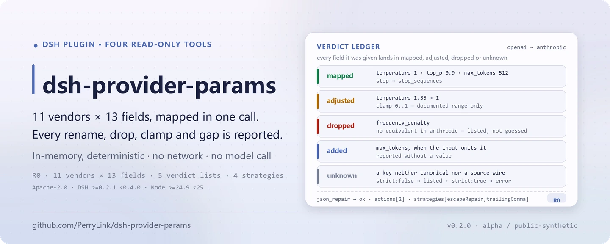

<div align="center">

<picture>
  <source media="(prefers-color-scheme: dark)" srcset="docs/assets/dsh-provider-params-hero-en-dark.webp">
  
</picture>

# dsh-provider-params

**Mapeie parâmetros de requisição entre 11 provedores de LLM e repare JSON quebrado com regras fixas — cada passo deixa um registro auditável.**

Um kit de ferramentas somente leitura para o DeepSeek Harness: `params.map` / `params.compare` / `params.vendors` tratam de `temperature`, `top_p`, `max_tokens`, `stop`, `system` e campos relacionados, enquanto `json.repair` trata de vírgulas finais, quebras de linha cruas e truncamento. Sem rede, sem gravação de arquivos, sem chamadas a modelo.

[Instalar](#instalação-em-três-passos) · [Configuração](#configuração) · [FAQ](#faq) · [简体中文](README.md) · [English](README.en.md) · [Español](README.es.md) · [Português](README.pt.md) · [हिन्दी](README.hi.md)

[](LICENSE)
[](#compatibilidade)
[](https://www.npmjs.com/package/dsh-provider-params)
[](https://github.com/PerryLink/dsh-provider-params/actions/workflows/ci.yml)
[](#compatibilidade)

[](https://github.com/PerryLink/dsh-provider-params/stargazers)
[](https://www.npmjs.com/package/dsh-provider-params)

```sh
dsh plugin --profile <profile> add dsh-provider-params
```

</div>

<sub>Plugin da comunidade, sem afiliação com a DeepSeek. Repositório canônico: <https://github.com/PerryLink/dsh-provider-params>. Status: alpha / sintético público / não GA; as quatro ferramentas são R0 (somente leitura).</sub>

## O que é

O `dsh-provider-params` mantém uma tabela de parâmetros de 11 provedores × 13 campos canônicos, traduz um fragmento de requisição dos wire names do provedor de origem para os do provedor de destino e relata o que aconteceu item por item: `mapped` é o resultado, `dropped` significa que o destino não tem equivalente, `added` que o destino exige mas a entrada não forneceu, `adjusted` que um intervalo documentado o recortou e `unknown` que a chave não foi reconhecida. O `params.compare` devolve um diff semântico de 13 linhas entre dois provedores, e o `params.vendors` lista o catálogo de campos. O `json.repair` repara JSON quebrado com uma sequência fixa de estratégias de texto/estrutura e devolve cada edição. As quatro ferramentas são cálculo puro em memória: sem rede, sem gravação de arquivos e sem chamadas a modelo.

- **Adequado para**: mover `temperature`, `top_p`, `max_tokens`, `stop`, `system` e campos relacionados entre OpenAI, Claude, Gemini, ERNIE, Qwen, DeepSeek, Mistral, Cohere, xAI, Groq e Azure OpenAI; auditar se um parâmetro foi renomeado, descartado, recortado para um intervalo documentado ou é obrigatório no destino mas falta na origem; reparar a saída de uma ferramenta que traz quebras de linha cruas, vírgulas finais ou uma string/contêiner truncado antes de analisá-la.
- **Não adequado para**: adivinhar dados de negócio ausentes ou chamar a API de um provedor — este pacote nunca inventa um valor e não tem caminho de rede; substituir um SDK de provedor, autenticação, streaming ou a construção completa da requisição — ele trabalha apenas sobre um fragmento de parâmetros e texto.

<picture>
  <source media="(prefers-color-scheme: dark)" srcset="docs/assets/dsh-provider-params-flow-v5-dark.svg">
  
</picture>

## Instalação em três passos

1. **Instalar** (escolha um canal):

   ```sh
   # canal npm (versões publicadas)
   dsh plugin --profile <profile> add dsh-provider-params
   # canal tarball: pnpm pack neste repositório e depois (prepublishOnly compila antes)
   dsh plugin --profile <profile> add ./dsh-provider-params-<version>.tgz
   ```

   O pacote npm já inclui o `lib/` compilado; instalar a partir do código git exige `pnpm install && pnpm build` neste repositório primeiro.

2. **Configuração mínima** (o comando de instalação aplica o bundle patch; um perfil escrito à mão cola esta única linha):

   ```yaml
   - insert:
       - id: dsh-provider-params
         name: 'dsh-provider-params'
   ```

   O plugin não tem chaves de configuração próprias; o `cordis.patch.yml` apenas faz `insert` de uma linha, e todo comportamento é passado como argumento da ferramenta.

3. **Verificar que monta**:

   ```sh
   dsh --profile <profile> --dump-config | grep dsh-provider-params
   node samples/quickstart/run.mjs
   ```

   A amostra imprime em ordem os resultados reais `== params.map ==` e `== json.repair ==`. Dentro de uma sessão também basta pedir:

   ```text
   Use as amostras incluídas para converter meu temperature/top_p/max_tokens/stop da OpenAI em parâmetros da Anthropic e depois reparar meu JSON quebrado que tem uma quebra de linha crua.
   ```

**Desinstalar**: `dsh plugin --profile <profile> remove dsh-provider-params` (ou remova a linha do patch do perfil).

## Recursos principais

- **Mapeamento entre provedores** — o `params.map` recebe `from`, `to` e um objeto `params`; os campos podem usar wire names da origem ou nomes canônicos, e o `generationConfig` do Google aceita forma aninhada ou com pontos. Devolve `mapped` / `dropped` / `added` / `adjusted` / `unknown`, e `strict: true` rejeita chaves desconhecidas.
- **Auditoria de diferenças semânticas** — o `params.compare` classifica cada campo como `same / renamed / removed / added / absent` em 13 linhas, com wire names, obrigatoriedade, intervalos documentados e notas dos dois lados.
- **Catálogo de campos por provedor** — o `params.vendors` lista 11 provedores e seus 13 campos com nome, suporte, obrigatoriedade, intervalo e notas; filtro opcional `vendor` e `include_unsupported`.
- **Reparação determinística de JSON** — o `json.repair` executa `escapeRepair`, `trailingComma`, `truncationClosure` e `fieldCompletion` em ordem fixa por no máximo 1–64 passos; `actions` registra cada edição e nenhum valor de negócio é inventado.
- **Somente leitura e auditável** — as quatro ferramentas são R0: sem gravação de arquivos, sem alterar originais, sem rede e sem chamadas a modelo; a saída existe apenas no resultado da ferramenta.

### Superfície de ferramentas

Os nomes das ferramentas são uma API estável; as quatro são somente leitura, determinísticas e sem rede.

| Ferramenta | Propósito | Risco |
|---|---|---|
| `params.map` | Mapear um fragmento de requisição do provedor de origem para o de destino e relatar mapped/dropped/added/adjusted/unknown | R0 |
| `params.compare` | Comparação semântica de parâmetros em 13 linhas entre dois provedores | R0 |
| `params.vendors` | Listar 11 provedores e seus campos | R0 |
| `json.repair` | Reparar JSON quebrado de forma determinística e devolver a lista de ações e marcadores | R0 |

### Entrada e saída

**Entrada**

- `params.map`: `from`, `to` e um objeto JSON `params`. Os campos podem usar wire names da origem ou nomes canônicos; o `generationConfig` do Google pode ser aninhado ou com pontos. `strict: true` opcional rejeita chaves desconhecidas.
- `params.compare`: dois ids de provedor.
- `params.vendors`: filtro opcional `vendor` e `include_unsupported`.
- `json.repair`: `text` (UTF-8, aceita cercas Markdown), `schema` opcional (subconjunto: `type`, `properties`, `required`, `additionalProperties`, `items`, `enum`, `const`), quatro interruptores de estratégia opcionais e `max_steps` opcional de 1–64.
- Escala: o texto é varrido em memória e limitado pelo limite de argumentos por chamada do host; o pacote não lê arquivos.
- Amostras incluídas: `samples/quickstart/input/params-request.json` e `samples/quickstart/input/broken-tool-output.json`.

**Saída**

- `params.map`: o objeto wire do destino (`mapped`) mais `dropped` (sem equivalente), `added` (obrigatório no destino mas ausente na entrada, **sem valor**), `adjusted` (recortado para um intervalo documentado) e `unknown` (chaves não reconhecidas).
- `params.compare`: 13 linhas semânticas classificadas `same / renamed / removed / added / absent`, com ambos os wire names, obrigatoriedade, intervalos documentados e notas.
- `params.vendors`: provedores suportados e seus campos (nome, suporte, obrigatoriedade, intervalo, notas).
- `json.repair`: `ok`, `repaired` (texto ou `null`), `value`, `actions` (cada edição), `strategies`, `truncated`, `validated`, `placeholders`, `error`.
- Nada é gravado em disco e o arquivo de entrada nunca é modificado. As quatro ferramentas são R0 (somente leitura).

### Exemplos

As amostras cobrem uma migração de parâmetros de OpenAI → Anthropic e uma saída de ferramenta com uma quebra de linha crua e uma vírgula final:

```sh
node samples/quickstart/run.mjs
```

- [`params-request.json`](samples/quickstart/input/params-request.json) mapeia `temperature: 1.35` da OpenAI para `temperature: 1` da Anthropic (recorte documentado 0..1, registrado em `adjusted` como 1.35 → 1), renomeia `stop` para `stop_sequences` e descarta `frequency_penalty` porque a Anthropic não tem equivalente. Gabarito: [`params-mapped.json`](samples/quickstart/expected/params-mapped.json).
- [`broken-tool-output.json`](samples/quickstart/input/broken-tool-output.json) contém uma quebra de linha crua dentro de `note` e uma vírgula final. A reparação registra uma ação `escape` e uma ação `strip` com `strategies: escapeRepair,trailingComma`. Gabarito: [`json-repaired.json`](samples/quickstart/expected/json-repaired.json).


*A captura é renderizada a partir da saída real de `node --test test/params.test.mjs test/repair.test.mjs` (24/24 aprovados); o comando, a data e o hash estão registrados em `screenshots.json`. A suíte completa tem 4 arquivos e 35 casos.*

### Regras de mapeamento

1. **Somente o que a tabela declara.** Uma célula `supported: false` é descartada com um motivo, nunca renomeada para um campo que pareça plausível.
2. **Obrigatório não significa inventado.** O `max_tokens` da Anthropic é obrigatório; se a entrada o omitir, ele aparece em `added` e nunca em `mapped` com um valor fabricado.
3. **Recortar apenas intervalos documentados.** O `temperature` da ERNIE (0.01..1) e o da Anthropic (0..1) são aplicados; notas de outros provedores não reescrevem um valor em silêncio.
4. **Aliases conflitantes falham.** Fornecer um nome canônico e um wire name de origem com valores diferentes devolve `E_PARAMS_CONFLICT`.
5. **Aninhamento do Google.** `generationConfig.*` é emitido como objeto aninhado; entrada aninhada também é aceita.

### Regras de reparação de JSON

O pipeline é fixo e nunca chama um modelo:

| Estratégia | Faz | Não faz |
|---|---|---|
| `escapeRepair` | Escapa caracteres de controle crus dentro de strings (`\n`, `\t`, `\uXXXX`) | Tocar em espaços fora de strings |
| `trailingComma` | Remove uma vírgula imediatamente antes de `}` / `]` | Remover um separador real |
| `truncationClosure` | Fecha uma string truncada e contêineres abertos | Adivinhar dados de negócio ausentes |
| `fieldCompletion` | Escreve `null` para um campo obrigatório ausente em um objeto existente | Criar um objeto pai ausente ou inventar um valor |

O `json.repair` aceita apenas raízes objeto/array; outras raízes devolvem `E_JSON_NOT_CONTAINER`. O subconjunto de schema é `type`, `properties`, `required`, `additionalProperties`, `items`, `enum`, `const`. Outras palavras-chave são rejeitadas com `E_JSON_SCHEMA_UNSUPPORTED` em vez de não validar nada. Um valor que ainda viola o schema falha de forma fechada com `E_JSON_SCHEMA_VIOLATION`, e o texto quebrado original nunca é reportado como sucesso.

## Dados medidos

`node scripts/acceptance.mjs` reexecuta as verificações de aceitação públicas/sintéticas; as seis linhas passam, citadas literalmente de [`ACCEPTANCE.csv`](ACCEPTANCE.csv):

| req_id | Métrica | Limite | Real | Resultado |
|---|---|---|---|---|
| PP-A01 | vendors listed | 11 | 11 | true |
| PP-A02 | canonical field count | 13 | 13 | true |
| PP-A03 | vendor-pair mappings clean | 121 | 121 | true |
| PP-A04 | deterministic repair strategies | 4 | 4 | true |
| PP-A05 | quickstart goldens match | 2 | 2 | true |
| PP-A06 | null placeholders reported | 1 | 1 | true |

Toda linha de aceitação é `source=public/synthetic` e `counted=false`; o hash de evidência é gravado em `ACCEPTANCE.csv`. São verificações públicas/sintéticas — sem dados de clientes ou evidência de clientes.

## Configuração

Este plugin não tem chaves de `Config` do Schemastery — o `cordis.patch.yml` apenas faz `insert` de uma linha (ver "Instalação em três passos"), então não há chave de nível de plugin para sobrescrever. Todo comportamento ajustável é um argumento da chamada da ferramenta.

Parâmetros mais usados:

| Parâmetro | Ferramenta | Padrão | Significado |
|---|---|---|---|
| `from` | `params.map` / `params.compare` | obrigatório | Id do provedor de origem; veja os 11 ids em `params.vendors` |
| `to` | `params.map` / `params.compare` | obrigatório | Id do provedor de destino |
| `params` | `params.map` | obrigatório | Fragmento de requisição; wire names da origem ou nomes canônicos |
| `strict` | `params.map` | `false` | `true` rejeita chaves desconhecidas com `E_PARAMS_UNKNOWN_PARAM` |
| `text` | `json.repair` | obrigatório | Texto JSON a reparar; cercas Markdown aceitas |
| `max_steps` | `json.repair` | `8` | Passes de varredura/aplicação para reparo de texto/estrutura, 1–64 |

<details>
<summary>Tabela completa de parâmetros (10 entradas)</summary>

| Parâmetro | Ferramenta | Padrão | Significado |
|---|---|---|---|
| `from` | `params.map` / `params.compare` | obrigatório | Id do provedor de origem |
| `to` | `params.map` / `params.compare` | obrigatório | Id do provedor de destino |
| `params` | `params.map` | obrigatório | Fragmento de requisição |
| `strict` | `params.map` | `false` | Se chaves desconhecidas falham |
| `vendor` | `params.vendors` | todos | Listar apenas um provedor; sem diferenciar maiúsculas |
| `include_unsupported` | `params.vendors` | `false` | Incluir campos sem equivalente |
| `text` | `json.repair` | obrigatório | Texto JSON a reparar |
| `schema` | `json.repair` | nenhum | Schema no subconjunto suportado, usado para completar e validar no final |
| `strategies` | `json.repair` | as quatro ligadas | `escape_repair` / `trailing_comma` / `truncation_closure` / `field_completion` |
| `max_steps` | `json.repair` | `8` | Inteiro de 1–64 |

</details>

## FAQ

<details>
<summary>Ele instala mas não vejo as ferramentas. E agora?</summary>

Confirme que o perfil carregou este pacote: `dsh --profile <profile> --dump-config | grep dsh-provider-params`. O plugin depende apenas do serviço `tools`; se o host não o oferecer, a montagem falha. Os códigos de erro e os passos de diagnóstico estão em [`TROUBLESHOOTING.md`](TROUBLESHOOTING.md).

</details>

<details>
<summary>O resultado mapeado não é o esperado.</summary>

Inspecione primeiro `dropped` e `adjusted`: o destino pode não ter equivalente, ou um intervalo documentado pode ter recortado o valor. Use `params.compare` para ver os dois wire names e os intervalos. Chaves desconhecidas aparecem em `unknown`; elas nunca entram no resultado em silêncio.

</details>

<details>
<summary>Ele consegue processar meus arquivos?</summary>

Não diretamente. Passe o texto JSON como `json.repair.text` e o objeto de parâmetros como `params.map.params`. Ele não lê disco, não chama a rede e não chama um modelo.

</details>

<details>
<summary>Ele inventa campos ausentes?</summary>

Não. `added` relata campos obrigatórios do destino sem valores. O preenchimento de campos obrigatórios escreve apenas marcadores `null` e relata seus caminhos em `placeholders`; o chamador precisa fornecer os valores reais.

</details>

<details>
<summary>Qual é a relação com o publicado <code>dsh-translate</code>?</summary>

Este pacote reescreve o mapeamento de parâmetros por provedor e a reparação determinística de JSON do `dsh-translate` na nova estrutura de pacote, com testes e documentação novos; o `dsh-translate` permanece como está. Ambos são código da PerryLink sob Apache-2.0.

</details>

## Limites de segurança

- **Somente leitura, nunca persistido.** As quatro ferramentas não gravam arquivos nem modificam originais; a saída existe apenas no resultado da ferramenta e nenhum estado sobrevive à chamada.
- **Sem rede, sem chamadas a modelo.** O código não contém chamadas HTTP / DNS / WebSocket nem um caminho de chamada a modelo; `dsh.demo.network` é `false`.
- **Sem valores inventados.** `added` relata campos obrigatórios do destino que faltam, sem valores; o preenchimento do `json.repair` escreve apenas marcadores `null`, relata seus caminhos em `placeholders` e deixa os valores reais para o chamador.
- **Intervalos recortam apenas onde documentado.** O `temperature` da ERNIE (0.01..1) e o da Anthropic (0..1) são os únicos recortes explícitos; notas de outros provedores nunca reescrevem um valor.
- **Falha fechada.** Palavras-chave de schema não suportadas, um valor que ainda viola o schema, nomes de estratégia desconhecidos e um `max_steps` fora do intervalo falham em voz alta; o texto quebrado original nunca é reportado como sucesso.

### Permissões e dados

- **Lê**: o objeto de parâmetros ou texto JSON fornecido pelo chamador; nenhum outro diretório.
- **Grava**: nada (R0, sem gravação de arquivos, originais intactos).
- **Rede**: não (sem caminho de requisição e sem interruptor de rede).
- **Sistemas externos**: nenhum.

### Códigos de erro

| Código | Significado | Próximo passo |
|---|---|---|
| `E_PARAMS_UNKNOWN_VENDOR` | O id de provedor não está na tabela | Use `params.vendors` para ver os 11 ids |
| `E_PARAMS_UNKNOWN_PARAM` | Chave desconhecida com `strict: true` | Remova a chave ou use `strict: false` |
| `E_PARAMS_CONFLICT` | Um parâmetro fornecido duas vezes com valores diferentes | Mantenha uma única grafia |
| `E_JSON_NOT_CONTAINER` | A raiz do texto não é objeto nem array | Passe o fragmento `{...}` / `[...]` da saída da ferramenta |
| `E_JSON_UNREPAIRABLE` | O texto ainda não analisa com as estratégias ativas | Alterne estratégias e tente de novo, ou peça ao upstream JSON completo |
| `E_JSON_SCHEMA_VIOLATION` | O valor reparado ainda viola o schema | Siga o caminho em `error.message` e forneça o valor real |
| `E_JSON_SCHEMA_UNSUPPORTED` | O schema usa uma palavra-chave não suportada | Use o subconjunto suportado |

Mais passos de diagnóstico em [`TROUBLESHOOTING.md`](TROUBLESHOOTING.md).

## Limitações conhecidas

- **A tabela é dado de documentação estática.** Os 11 provedores × 13 campos canônicos foram organizados a partir de documentação pública de API; os três provedores `ported` (OpenAI, ERNIE, Qwen) vêm do GPT-Rosetta-Stone e as linhas `extended` seguem a referência pública de cada provedor. Não há replay contra a API ao vivo, então a documentação oficial vence quando um provedor muda.
- **Apenas 13 campos canônicos são cobertos.** Extras específicos de cada provedor não são modelados; aparecem como `unknown` ao mapear ou simplesmente não estão na tabela de comparação.
- **A reparação de JSON é uma heurística de texto/estrutura.** Ela não entende semântica de negócio e ainda pode devolver `E_JSON_UNREPAIRABLE`; o `schema` suporta apenas o subconjunto declarado, não `oneOf`, `$ref`, `allOf` e palavras-chave semelhantes.
- **Não é um SDK de provedor.** Não substitui autenticação, streaming, retentativas ou a construção completa da requisição; trabalha apenas com um fragmento de parâmetros e texto.
- **Não lê arquivos.** O JSON precisa ser passado como `text`; textos grandes são limitados pelo limite de argumentos por chamada do host.
- **alpha / sintético público / não GA.** Verificado apenas com amostras públicas ou sintéticas; sem dados ou evidência de clientes e sem declaração de prontidão para produção.

## Compatibilidade

| Superfície | Estado |
|---|---|
| Harness | `dsh >=0.2.1-rc.3 <0.4.0` (`engines.dsh` no `package.json`) |
| Node | `>=24.9.0 <25` (`engines.node` no `package.json`) |
| Plataformas | Todas; apenas cálculo em memória |
| Dados | Sem rede, sem chamada a modelo, sem upload |
| Dependências | `@deepseek-ai/cordis`, `@deepseek-ai/dsh-tools` (peer opcional); sem nova dependência de execução |
| Ferramentas | As quatro são R0 (somente leitura) |

## Ecossistema e qualidade

- [Índice de plugins da PerryLink](https://perrylink.github.io/dsh-plugins/): a página deste pacote é [dsh-provider-params](https://perrylink.github.io/dsh-plugins/packages/dsh-provider-params.html) (versão e link npm)
- [Visão geral da família de plugins](https://perrylink.github.io/dsh-plugins/family.html) (tudo Apache-2.0)
- [Página do pacote no npm](https://www.npmjs.com/package/dsh-provider-params) (versão e downloads)

## Desenvolvimento

```sh
pnpm install
pnpm build
pnpm lint
pnpm typecheck
node --test test/*.test.mjs
node scripts/gate.mjs
```

O `node scripts/gate.mjs` executa lint, `tsc --noEmit`, a compilação, o script de aceitação e todos os testes. As linhas de aceitação são gravadas em `ACCEPTANCE.csv` como public/synthetic, `counted=false`.

Versão atual `0.1.0` (igual ao `package.json`); a suíte tem 4 arquivos e 35 casos. Estrutura:

| Caminho | Conteúdo |
|---|---|
| `src/core/` | Núcleo de funções puras: `rosetta` (tabela), `mapping`, `repair`, `json`, `errors`; sem dependência de Cordis |
| `src/plugin/` | `index.ts` (apply) e `tools.ts` (as quatro definições de ferramenta) |
| `test/` | Suítes `node --test` de `params` / `repair` / `plugin-smoke` / `samples` |
| `samples/quickstart/` | Entradas sintéticas, saídas gabarito e `run.mjs` |
| `scripts/` | `acceptance.mjs`, `gate.mjs`, `lint.mjs`, `gen-readme-assets.py` |
| `docs/assets/` | Imagens do README (hero SVG claro/escuro, captura do quickstart) |

As imagens do README são geradas programaticamente por [`scripts/gen-readme-assets.py`](scripts/gen-readme-assets.py) (Python + Pillow; fluxo SVG claro/escuro compartilhado pelos cinco idiomas) e podem ser repetidas:

```sh
python scripts/gen-readme-assets.py
```

Topics: `deepseek-harness`, `dsh`, `dsh-plugin`, `provider`, `parameter-mapping`, `json-repair`, `llm-api`, `perrylink`

## Família e agradecimentos

Este projeto faz parte da família de plugins do DeepSeek Harness da [PerryLink](https://github.com/PerryLink) (todos Apache-2.0). Se for útil, **uma estrela ajuda a próxima pessoa a encontrá-lo** — nada fica bloqueado por trás dela.

- [@PerryLink](https://github.com/PerryLink) — criador e mantenedor: a tabela de 11 provedores, as quatro ferramentas somente leitura, a amostra quickstart e a suíte de aceitação, e a documentação em cinco idiomas.
- As três linhas `ported` vêm do GPT-Rosetta-Stone da PerryLink (Apache-2.0); este pacote reescreve o mapeamento de parâmetros por provedor e a reparação determinística de JSON do `dsh-translate` na nova estrutura.

<details>
<summary>Expandir todos os plugins</summary>

| Plugin | Status |
|---|---|
| **[dsh-aqua-input-check](https://github.com/PerryLink/dsh-aqua-input-check)** |  |
| **[dsh-archive-check](https://github.com/PerryLink/dsh-archive-check)** |  |
| **[dsh-auto-review](https://github.com/PerryLink/dsh-auto-review)** |  |
| **[dsh-autotier](https://github.com/PerryLink/dsh-autotier)** | 🧊 CONGELADO — ver o README do repo |
| **[dsh-bid-ca-precheck](https://github.com/PerryLink/dsh-bid-ca-precheck)** |  |
| **[dsh-bid-qual-check](https://github.com/PerryLink/dsh-bid-qual-check)** |  |
| **[dsh-cert-mcp](https://github.com/PerryLink/dsh-cert-mcp)** | 🧊 CONGELADO — ver o README do repo |
| **[dsh-checkpoint-rewind](https://github.com/PerryLink/dsh-checkpoint-rewind)** |  |
| **[dsh-click](https://github.com/PerryLink/dsh-click)** |  |
| **[dsh-composer-history](https://github.com/PerryLink/dsh-composer-history)** |  |
| **[dsh-contract-stance](https://github.com/PerryLink/dsh-contract-stance)** |  |
| **[dsh-customs-doc-check](https://github.com/PerryLink/dsh-customs-doc-check)** |  |
| **[dsh-data-quality](https://github.com/PerryLink/dsh-data-quality)** |  |
| **[dsh-demurrage-ledger](https://github.com/PerryLink/dsh-demurrage-ledger)** |  |
| **[dsh-doublecheck](https://github.com/PerryLink/dsh-doublecheck)** |  |
| **[dsh-drill-script-check](https://github.com/PerryLink/dsh-drill-script-check)** |  |
| **[dsh-eia-guide-check](https://github.com/PerryLink/dsh-eia-guide-check)** |  |
| **[dsh-emergency-plan](https://github.com/PerryLink/dsh-emergency-plan)** |  |
| **[dsh-essay-rubric-check](https://github.com/PerryLink/dsh-essay-rubric-check)** |  |
| **[dsh-evidence-check](https://github.com/PerryLink/dsh-evidence-check)** |  |
| **[dsh-export-ctl-check](https://github.com/PerryLink/dsh-export-ctl-check)** |  |
| **[dsh-fast](https://github.com/PerryLink/dsh-fast)** |  |
| **[dsh-fmea-table-check](https://github.com/PerryLink/dsh-fmea-table-check)** |  |
| **[dsh-forecast-penalty](https://github.com/PerryLink/dsh-forecast-penalty)** |  |
| **[dsh-fund-research](https://github.com/PerryLink/dsh-fund-research)** |  |
| **[dsh-github](https://github.com/PerryLink/dsh-github)** |  |
| **[dsh-gongwen-flow-check](https://github.com/PerryLink/dsh-gongwen-flow-check)** |  |
| **[dsh-gongwen-word-check](https://github.com/PerryLink/dsh-gongwen-word-check)** |  |
| **[dsh-guard-plan-qc](https://github.com/PerryLink/dsh-guard-plan-qc)** |  |
| **[dsh-hazchem-check](https://github.com/PerryLink/dsh-hazchem-check)** |  |
| **[dsh-hazplan-check](https://github.com/PerryLink/dsh-hazplan-check)** |  |
| **[dsh-hidden-risk-map](https://github.com/PerryLink/dsh-hidden-risk-map)** |  |
| **[dsh-hs-classify](https://github.com/PerryLink/dsh-hs-classify)** |  |
| **[dsh-icd-rule-check](https://github.com/PerryLink/dsh-icd-rule-check)** |  |
| **[dsh-industry-research](https://github.com/PerryLink/dsh-industry-research)** |  |
| **[dsh-lawcite-adapter](https://github.com/PerryLink/dsh-lawcite-adapter)** |  |
| **[dsh-laya](https://github.com/PerryLink/dsh-laya)** |  |
| **[dsh-lc-doc-check](https://github.com/PerryLink/dsh-lc-doc-check)** |  |
| **[dsh-learning-gap-check](https://github.com/PerryLink/dsh-learning-gap-check)** |  |
| **[dsh-library](https://github.com/PerryLink/dsh-library)** |  |
| **[dsh-local-ai](https://github.com/PerryLink/dsh-local-ai)** |  |
| **[dsh-lsp-actions](https://github.com/PerryLink/dsh-lsp-actions)** |  |
| **[dsh-mask](https://github.com/PerryLink/dsh-mask)** |  |
| **[dsh-mcp-panel](https://github.com/PerryLink/dsh-mcp-panel)** |  |
| **[dsh-medrec-qc](https://github.com/PerryLink/dsh-medrec-qc)** |  |
| **[dsh-memento](https://github.com/PerryLink/dsh-memento)** |  |
| **[dsh-nsfc-form-check](https://github.com/PerryLink/dsh-nsfc-form-check)** |  |
| **[dsh-nurse-record-check](https://github.com/PerryLink/dsh-nurse-record-check)** |  |
| **[dsh-observe](https://github.com/PerryLink/dsh-observe)** |  |
| **[dsh-origin-rvc-check](https://github.com/PerryLink/dsh-origin-rvc-check)** |  |
| **[dsh-ota-review-check](https://github.com/PerryLink/dsh-ota-review-check)** |  |
| **[dsh-output-styles](https://github.com/PerryLink/dsh-output-styles)** |  |
| **[dsh-paper-doc-adapter](https://github.com/PerryLink/dsh-paper-doc-adapter)** |  |
| **[dsh-permission-rules](https://github.com/PerryLink/dsh-permission-rules)** |  |
| **[dsh-permit-report-check](https://github.com/PerryLink/dsh-permit-report-check)** |  |
| **[dsh-pipeline-check](https://github.com/PerryLink/dsh-pipeline-check)** |  |
| **[dsh-pleading-draft](https://github.com/PerryLink/dsh-pleading-draft)** |  |
| **[dsh-plugin-doctor](https://github.com/PerryLink/dsh-plugin-doctor)** | 🚫 APOSENTADO (repo arquivado) |
| **[dsh-plugin-guide](https://github.com/PerryLink/dsh-plugin-guide)** |  |
| **[dsh-plugin-kit](https://github.com/PerryLink/dsh-plugin-kit)** | 🚫 APOSENTADO (repo arquivado) |
| **[dsh-plugin-upgrade](https://github.com/PerryLink/dsh-plugin-upgrade)** | 🚫 APOSENTADO (repo arquivado) |
| **[dsh-policy-brief-draft](https://github.com/PerryLink/dsh-policy-brief-draft)** |  |
| **[dsh-power-loss-split](https://github.com/PerryLink/dsh-power-loss-split)** |  |
| **[dsh-power-ticket-check](https://github.com/PerryLink/dsh-power-ticket-check)** |  |
| **[dsh-ppap-check](https://github.com/PerryLink/dsh-ppap-check)** |  |
| **[dsh-protest-deadline](https://github.com/PerryLink/dsh-protest-deadline)** |  |
| **[dsh-railway-window](https://github.com/PerryLink/dsh-railway-window)** |  |
| **[dsh-repair-order-qc](https://github.com/PerryLink/dsh-repair-order-qc)** |  |
| **[dsh-research-report](https://github.com/PerryLink/dsh-research-report)** |  |
| **[dsh-review-reply-check](https://github.com/PerryLink/dsh-review-reply-check)** |  |
| **[dsh-rulefile-check](https://github.com/PerryLink/dsh-rulefile-check)** |  |
| **[dsh-safety-brief-check](https://github.com/PerryLink/dsh-safety-brief-check)** |  |
| **[dsh-score](https://github.com/PerryLink/dsh-score)** |  |
| **[dsh-session-sync](https://github.com/PerryLink/dsh-session-sync)** |  |
| **[dsh-site-log-check](https://github.com/PerryLink/dsh-site-log-check)** |  |
| **[dsh-skill-pack-security](https://github.com/PerryLink/dsh-skill-pack-security)** |  |
| **[dsh-soe-decision-check](https://github.com/PerryLink/dsh-soe-decision-check)** |  |
| **[dsh-soilwater-check](https://github.com/PerryLink/dsh-soilwater-check)** |  |
| **[dsh-sop-sync-check](https://github.com/PerryLink/dsh-sop-sync-check)** |  |
| **[dsh-spc-gbt-adapter](https://github.com/PerryLink/dsh-spc-gbt-adapter)** |  |
| **[dsh-talk](https://github.com/PerryLink/dsh-talk)** |  |
| **[dsh-tender-extract](https://github.com/PerryLink/dsh-tender-extract)** |  |
| **[dsh-tender-matrix](https://github.com/PerryLink/dsh-tender-matrix)** |  |
| **[dsh-test-drive](https://github.com/PerryLink/dsh-test-drive)** |  |
| **[dsh-ticktick](https://github.com/PerryLink/dsh-ticktick)** | 🚫 APOSENTADO (repo arquivado) |
| **[dsh-translate](https://github.com/PerryLink/dsh-translate)** |  |
| **[dsh-warranty-calc](https://github.com/PerryLink/dsh-warranty-calc)** |  |
| **[dsh-budget](https://github.com/PerryLink/dsh-budget)** | 🧊 CONGELADO — ver o README do repo |
| **[dsh-claude-move](https://github.com/PerryLink/dsh-claude-move)** | 🧊 CONGELADO — ver o README do repo |
| **[dsh-defend](https://github.com/PerryLink/dsh-defend)** | 🧊 CONGELADO — ver o README do repo |
| **[dsh-draw](https://github.com/PerryLink/dsh-draw)** | 🧊 CONGELADO — ver o README do repo |
| **[dsh-reach](https://github.com/PerryLink/dsh-reach)** | 🧊 CONGELADO — ver o README do repo |
| **[dsh-background-agents](https://github.com/PerryLink/dsh-background-agents)** | 🚫 APOSENTADO (repo arquivado) |
| **[dsh-session-pin](https://github.com/PerryLink/dsh-session-pin)** | 🚫 APOSENTADO (repo arquivado) |
| **[dsh-team-rooms](https://github.com/PerryLink/dsh-team-rooms)** | 🚫 APOSENTADO (repo arquivado) |

</details>

## Licença

[LICENSE](LICENSE) (Apache License 2.0) © 2026 dsh-provider-params contributors

<p align="center"><sub>Apache-2.0 · Plugin da comunidade, sem afiliação com a DeepSeek.</sub></p>
